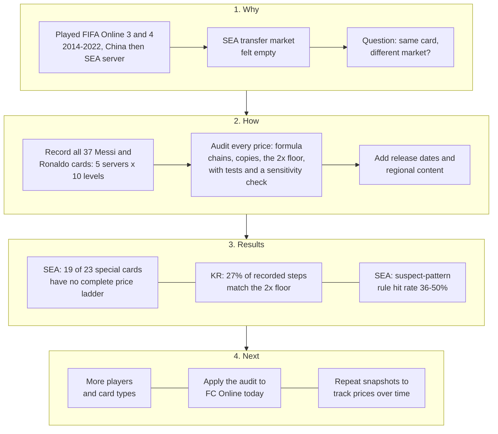

# Same Card, Different Records: An Audit of Third-Party FIFA Online 3 Prices for Korea and Southeast Asia

**Zhang Lin Si Cheng (Toni)**
Independent working paper, version 2, October 2026. Not peer reviewed.
Repository: [github.com/Shelikeit69/fo3-market-audit](https://github.com/Shelikeit69/fo3-market-audit)
[中文版](README.zh-CN.md)

[](https://github.com/Shelikeit69/fo3-market-audit/actions/workflows/tests.yml)

---

## Abstract

FIFA Online 3 sold the same player cards in Korea, a large market run by Nexon, and in four smaller Southeast Asian markets run by Garena. A fan site still shows one recorded price per card, server and enhancement level. This paper asks what those records reveal about prices in each region and whether they can support claims about how the markets worked. Using 1,105 recorded prices for all 37 Messi and Ronaldo cards, I apply a tested, rule-based audit that flags prices that match exact multipliers, copies across servers or the game's documented price floor, within a stated rounding allowance. Three patterns appear. First, 19 of 23 special cards have no complete price ladder for Southeast Asia. Second, none of 333 Korean level-to-level steps falls below the documented minimum of twice the previous level, and 27% match exactly twice the previous level within the rounding allowance. Third, on the 18 cards with complete ladders everywhere, the suspect-pattern rule hit rate (a formula chain, a cross-server copy or a price inversion) is 36% to 50% for Southeast Asia, against 0% for Korea on the same cards. These are patterns in a third-party record, not direct evidence of trading. Thin trading is one explanation consistent with them; the site's own gap filling, different collection times and cards never released locally are others. I set out what each explanation would predict and treat the operating recommendations that follow as hypotheses.

**Keywords:** virtual economies; thin markets; price floors; data quality; live operations; FIFA Online 3

---

## 1. Introduction

### 1.1 Motivation

I played FIFA Online 3 and 4 from 2014 to 2022, first on the China server and then on Garena's Southeast Asia server. On the Southeast Asia server the transfer market often felt empty: few listings, odd prices and long waits. That experience raised a practical question for anyone running one game in several regions: does a product that works in a large home market behave the same way in a small one?

### 1.2 Research question

> The same player card was sold in a large market (Korea) and in small markets (Thailand, Vietnam, Singapore/Malaysia and Indonesia). What do the surviving price records show for each region, and how far can they support conclusions about price formation and about copying Korea's live-operations approach into a smaller region?

The question breaks into three parts that the data can address directly:

1. **Coverage:** for how many cards does the record show no usable Southeast Asia price?
2. **Patterns:** among cards with complete records, how many prices show a suspect pattern (a formula, a copy or an inversion) rather than varying freely?
3. **Rules:** how often do Korean steps match the game's documented price floor of twice the previous level?

Whether these patterns were caused by thin trading is a fourth question. The data cannot answer it alone; Section 7 discusses it as a hypothesis.

### 1.3 Contribution

This is a small descriptive study, not a new method. It offers (a) a transparent, tested and reproducible audit of a public third-party price record; (b) evidence that a documented trading rule is visible in about a quarter of Korean price steps; and (c) a set of testable hypotheses linking the findings to release decisions for small regional markets.

### 1.4 Roadmap



---

## 2. Related Work

**Virtual economies as economies.** Castronova [1] treated the online world of EverQuest as a national economy, estimating output, wages and a currency exchange rate from player surveys and auction listings. Two of his observations matter here. Prices paid by the game's own merchants act as a floor for item prices, and because items do not wear out, supply accumulates and the premium on new items fades. Lehdonvirta and Castronova [2] develop these ideas into a design framework covering currency sources and sinks, inflation and market design.

**Thin markets and player exit.** Drachen et al. [3] analysed about 2.9 million auction records from the browser game Glitch until it closed. As monthly players fell from 4,632 to 723, daily auctions fell sharply, and after the closure was announced price volatility rose and half of all items lost value. Their study is the closest analogue to a market with too few traders.

**Interventions and third-party data.** Hogan-Hennessy et al. [4] studied a transaction tax and an item sink in Old School RuneScape using daily prices collected by a third-party client used by about 75% of players. They report effects with confidence intervals and state that the data do not cover the whole market and that the developer's aims were not published, so success cannot be judged. Their treatment of incomplete third-party data is the model for this paper.

**Gap.** These studies each look at one market. This paper compares the same goods across servers of one game, one large and several small, using a public fan-site record whose quality must itself be checked before anything else can be said.

---

## 3. Background: FIFA Online 3

FIFA Online 3 was developed by EA and published by Nexon in Korea from December 2012, by Tencent in China from 2014 and by Garena in Thailand, Vietnam, Singapore/Malaysia and Indonesia from 2013 to 2014 [5, 6]. The Southeast Asia service closed on 30 June 2020 [7]; the Korean service closed in 2018 after FIFA Online 4 launched [6].

Players bought and sold player cards on an in-game transfer market using the game currency, EP. A card could be enhanced from +1 to +10 by combining copies, with success becoming less likely at higher levels [6]. Two rules from the community wiki [6] matter for this paper:

- **Price band:** each card traded within ±10% of a base price, and the base moved when many trades hit the upper or lower limit.
- **Enhancement floor:** a card one level higher could not be priced below twice the price of the level beneath it.

On refresh timing, my own recollection is that prices on the China server updated every 15 minutes. I did not observe this on the Southeast Asia server, and the wiki gives one to two hours for Korea [6], so the interval may have differed by region.

---

## 4. Data

**Source.** FIFA Addict, a fan site, publishes a FIFA Online 3 card database [8]. Each card page lists a price for ten enhancement levels on five servers: Korea (KR), Thailand (TH), Vietnam (VN), Singapore (SG) and Indonesia (ID). The site does not describe how prices were collected, how often each server was updated or how gaps were filled.

**Sample.** All cards of two players: Messi (18 cards) and Ronaldo (19 cards), 37 cards in total. I chose these players because they are among the most traded, so their records should be the fullest available. Cards were grouped as *ordinary seasons* (yearly cards for 2006 to 2011 and 2017, 14 cards) and *special* cards (tournament, Champions League, World Best, Loyal Player, Captain and Continental Champion cards, 23 cards). Appendix B lists every card with a link to its source page.

**Size.** 37 cards × 5 servers × 10 levels gives 1,850 possible prices, of which 1,105 are present.

**Two different dates.** The *collection date* is when I read the pages: October 2026. The *price date* is when the site recorded each price, which is not shown per price. The record includes the 2017 season cards, released in Korea on 30 November 2017 [9], so the database contains records added on or after that date. This sets a lower bound only for those cards: prices for older cards may have been recorded earlier and never updated. The site says Korean prices were last updated "about 9 years ago" without saying which. No date is shown for Southeast Asia prices, so they may come from a different time than the Korean ones.

**Collection and checks.** Pages were read one at a time and transcribed to CSV. As an accuracy check, the 50 prices for the Ronaldo 2017 card were compared with a screenshot of the same page; all 50 matched. Copies of the other source pages were not archived, so a reader who wants to verify a price must use the live page linked in Appendix B, which may change.

**Release dates.** Korean release dates for six card types came from news reports and the community wiki [9, 10, 11]. Southeast Asia release dates were searched for in Vietnamese, Thai and English sources; only one could be found [12].

---

## 5. Method

### 5.1 Steps and ladders

A **step** compares a price with the price one level below it, on the same card and server. Steps are only formed between adjacent levels: if +2 is missing, +3 is not compared with +1. A card's prices on one server form a **ladder**, which is *complete* if every level from +1 to +10 is present once, *lone* if only +1 is present, and *partial* otherwise.

### 5.2 Flags

*Table 1. Audit flags*

| Flag | Rule | Reason |
|---|---|---|
| Formula chain | Two adjacent steps rise by the same multiplier (×1.5, ×2.3 or ×3) within the rounding allowance | Freely varying prices rarely repeat an exact multiplier |
| Floor match | A step equals ×2.00 within the rounding allowance | Consistent with the minimum the rules allow |
| Cross-server copy | Two or more servers show the same price for the same card and level | Independent records rarely match to the last digit |
| Price inversion | A higher level is cheaper than the level below | Not consistent with the floor rule |
| Insufficient coverage | The ladder is lone or partial | Too little data to judge patterns |

Two summary labels are kept separate in the output. **Suspect pattern** means a formula chain, a cross-server copy or a price inversion. **Insufficient coverage** means the ladder is not complete. Floor matches are reported on their own because they are consistent with a documented rule rather than a gap in the data; a match does not show that the rule actually constrained a trade. In the text, the share of prices with a suspect pattern is called the **rule hit rate**: it measures how often the record matches these rules, not a verified share of estimated prices.

### 5.3 Rounding allowance

The site shows most prices to 0.1 million EP. For a step with multiplier *k*, the rounding error in *price − k × previous* is at most 0.05M + *k* × 0.05M, which is no more than 0.1M × *k*. The default allowance is therefore 100,000 EP per unit of multiplier. Small prices are sometimes shown with finer precision, so for them the allowance is generous. When a step falls within the allowance of two multipliers, the closer one is used. Section 6.4 shows how the results change with the allowance.

The multipliers 1.5, 2.3 and 3 were not chosen in advance; they were the values that repeated in the data. This is a limitation discussed in Section 8.

### 5.4 Software and tests

The functions are in [`fo3audit.py`](fo3audit.py) and the report in [`audit.py`](audit.py). The input is checked before use: required columns must exist, each card and level must appear once, levels must be whole numbers from 1 to 10, card details must not be missing and every price must be positive and finite. Any failure stops the run with an error. Nineteen automated tests in [`tests/`](tests/) cover the published numbers, gaps between levels, bad input, formula chains, the floor and ladder status. They run on every push through GitHub Actions, which also checks that the committed outputs can be reproduced exactly.

---

## 6. Results


*Figure 1. Left: recorded price by enhancement level for the Ronaldo 2017 card on each server. Right: step ratios on complete ladders, on a log scale with no values cut off; the dashed line marks the 2× floor. Forty-two steps have a ratio above 4.*

### 6.1 Coverage: special cards lack Southeast Asia records

All 14 ordinary season cards have complete ladders on every server. Of the 23 special cards, only 4 have complete ladders for Southeast Asia (World Best and 2014 World Cup, for both players). Fifteen show a single Thailand price for +1 and nothing else; in 7 of those 15 the Thailand price is higher than the Korean one. Four show no Southeast Asia price at all. Every special card has a complete Korean ladder.

### 6.2 Rules: a quarter of Korean steps match the floor

Across 333 Korean steps, none falls below 2× and 91 (27%) are consistent with exactly 2× within the rounding allowance. The share is similar for ordinary cards (32 of 126, 25%) and special cards (59 of 207, 29%). The Korean record is consistent with the floor rule described in the wiki. Whether the rule actually constrained trades at those levels cannot be seen in the data.

### 6.3 Patterns: many Southeast Asia records show a suspect pattern

*Table 2. Rule hit rate (share of prices with a suspect pattern) on complete ladders*

| Server | All complete ladders | Same 18 cards on every server | Steps below the 2× floor |
|---|---|---|---|
| KR | 0.5% (2 of 370) | 0.0% (0 of 180) | 0 of 333 |
| TH | 41.1% | 41.1% | 62 of 162 |
| VN | 36.1% | 36.1% | 9 of 162 |
| SG | 50.0% | 50.0% | 35 of 162 |
| ID | 46.7% | 46.7% | 39 of 162 |

Korea has complete ladders for all 37 cards; the other servers have them for 18. The middle column compares like with like.

The same sequence of values also appears on different cards. For example, 678.5M, 1,560.5M, 3,589.1M and 8,254.9M (each ×2.3 the last) appear on Ronaldo's 2007 card and again, one level higher, on his 2009 card. Singapore and Indonesia often show identical prices from the middle levels upward. Per-price flags are in `data/audit_cells.csv`.

### 6.4 Sensitivity to the rounding allowance

*Table 3. Rule hit rate by rounding allowance (EP per unit of multiplier)*

| Allowance | KR | TH | VN | SG | ID |
|---|---|---|---|---|---|
| 0 | 0.0% | 31.1% | 10.6% | 44.4% | 38.3% |
| 50,000 | 0.0% | 40.0% | 35.6% | 48.9% | 45.0% |
| 100,000 (default) | 0.5% | 41.1% | 36.1% | 50.0% | 46.7% |
| 150,000 | 0.5% | 41.1% | 36.1% | 51.1% | 46.7% |

With no allowance, most Vietnam formula steps disappear, because exact equality fails once prices are rounded. From 50,000 to 150,000 the rates change by at most 2.2 percentage points (Singapore, 48.9% to 51.1%). The external review of version 1 reported 37.2% for Vietnam at 150,000; version 2 gives 36.1% because a step that fits two multipliers now takes the closer one (Section 5.3) instead of the first one checked. The ordering of the four Southeast Asia servers is the same at every allowance, and Korea stays near 0% throughout. The exact percentages depend on the allowance; the contrast with Korea does not.

### 6.5 Release timing and regional content

*Table 4. Release dates found*

| Card type | Korea release | Southeast Asia | Complete SEA ladders in sample? |
|---|---|---|---|
| 2014 World Cup | 22 May 2014 [10] | Already listed in Vietnam by 30 May 2014 [12] | Yes |
| World Legend | 25 Nov 2014 [9] | Not found | Not sampled |
| 2010 World Cup | 1 Jan 2016 [9] | Not found | No |
| Euro / Copa 2016 | 1 Jun 2016 [9] | Not found | No |
| Loyal Player | Jan 2017 [9] | Not found | No |
| Continental Champion | 31 Aug 2017 [11] | Not found | No |
| 2017 season | 30 Nov 2017 [9] | Not found | Yes |

Garena also added content of its own: three Malaysian football figures in July 2016 [13], and a Vietnam national team in the 2014 World Cup mode [14]. That report names VED, not Garena, as the Vietnam operator, which conflicts with other sources [5].

---

## 7. Discussion

### 7.1 What the record shows

The audit establishes three things about the record itself: Southeast Asia prices are missing for most special cards, about a quarter of Korean steps match the floor rule, and a large share of Southeast Asia prices show a suspect pattern. It does not establish how those prices came about.

### 7.2 Possible explanations

*Table 5. Explanations consistent with the patterns, and what would tell them apart*

| Explanation | Consistent with | Would be supported by |
|---|---|---|
| **Thin trading.** Too few trades in small markets for a price to form | Missing special cards; formula and copy patterns | Similar patterns on other fan sites; lower listing counts in Southeast Asia from any surviving source |
| **Gap filling by the site.** FIFA Addict estimated missing prices with fixed multipliers or copied a neighbouring server | Repeated ×2.3 sequences across cards; Singapore equal to Indonesia | The site's code or staff confirming a filling rule; the same multipliers on unrelated players |
| **Different collection times.** Southeast Asia prices were recorded at another time, or stopped updating | Southeast Asia gaps; no update date shown | Archived page versions with dates |
| **Cards never released locally.** Some special cards did not exist in Southeast Asia | Special cards with no Southeast Asia price | Official Southeast Asia release notes |

These explanations are not exclusive. The repeated ×2.3 sequence across two different cards fits gap filling better than independent trading. Thin trading could still be the reason gaps existed to be filled. The data here cannot separate the two.

### 7.3 Hypotheses for operating a small market

If thin trading is part of the explanation, the findings suggest the following operating hypotheses. They are untested and would need evidence of the kinds listed in Table 5.

1. **Fewer card types concentrate trading.** In this sample, the only card types with complete Southeast Asia ladders were the ordinary seasons, World Best and the 2014 World Cup set.
2. **Major tournament sets can stay in step with Korea.** The 2014 World Cup set reached Vietnam within about a week and has complete ladders in this sample.
3. **A shared regional market adds depth.** One Southeast Asia market would put more buyers and sellers behind each card than four separate ones.
4. **Local content can be the main localisation effort,** as with Garena's Malaysian legends, rather than matching every Korean release.

A related observation from my own experience: on the China server, Tencent ran FIFA Online 3 and FIFA Online 4 side by side, so players were split across two games and many stayed on FIFA Online 3. If thin trading matters, that split would work in the same direction.

---

## 8. Limitations

1. **Third-party record, not market data.** The audit describes FIFA Addict's record. It cannot show trades, listings or volume.
2. **Unknown timing.** Prices have no dates. The presence of 2017 season cards shows only that some records were added on or after 30 November 2017; older cards' prices may be earlier, and Southeast Asia prices may come from a different time.
3. **Two players.** Messi and Ronaldo are among the most traded cards, so the results are not averages for the market.
4. **Data-driven thresholds.** The multipliers used to detect formula chains were found in the same data they flag. A larger sample should test them on cards not used to choose them.
5. **Depends on the rounding allowance.** Exact rates move with the allowance (Table 3); the comparison with Korea does not.
6. **Secondary sources for rules.** The price band and floor rules come from a community wiki and my own memory, not from official documents.
7. **Manual transcription without archives.** Prices were read page by page. One card was checked in full against a screenshot; the other pages were not archived.

---

## 9. Conclusion and Future Work

In this record, the same FIFA Online 3 cards look different for Korea and for Southeast Asia. Korean ladders are complete, and about a quarter of their steps match the documented floor. Southeast Asia prices are missing for most special cards, and on cards that are covered the suspect-pattern rule hit rate is 36% to 50%. Thin trading is one explanation consistent with this, but gap filling by the site, different collection times and cards never released locally could produce the same patterns. The recommendations in Section 7.3 should be read as hypotheses to test.

Next steps:

1. **Separate the explanations** in Table 5, starting with archived page versions and other fan sites.
2. **Widen the sample** to more players and card types, and test the multipliers on cards not used to choose them.
3. **Apply the same audit to FC Online,** the game's current version, using repeated snapshots so prices can be tracked over time.

---

## Version history

- **Version 1** (21 October 2026): first release.
- **Version 2** (21 October 2026): revised after an external review. Conclusions restricted to what the record shows, with alternative explanations (Table 5). Steps now compare adjacent levels only; complete ladders defined explicitly; input validation added; cross-server copies counted by distinct servers; "suspect pattern" and "insufficient coverage" separated; closest-multiplier rule added; tests and continuous integration added; sensitivity analysis (Table 3), same-card comparison (Table 2) and an uncut log-scale chart added; dependency versions pinned; floor binding renamed floor match; dating claim limited to a lower bound for 2017 cards. The main reported numbers are unchanged, apart from the version 1 review's sensitivity check (Section 6.4).

---

## References

[1] Castronova, E. (2001). *Virtual Worlds: A First-Hand Account of Market and Society on the Cyberian Frontier* (CESifo Working Paper No. 618). CESifo. https://www.cesifo.org/en/publications/2001/working-paper/virtual-worlds-first-hand-account-market-and-society-cyberian

[2] Lehdonvirta, V., & Castronova, E. (2014). *Virtual Economies: Design and Analysis*. MIT Press.

[3] Drachen, A., Riley, J., Baskin, S., & Klabjan, D. (2016). Going out of business: Auction house behavior in the massively multi-player online game Glitch. *arXiv preprint* arXiv:1603.07610. https://arxiv.org/abs/1603.07610

[4] Hogan-Hennessy, S., Xenopoulos, P., & Silva, C. (2022). Market interventions in a large-scale virtual economy. *arXiv preprint* arXiv:2210.07970. https://arxiv.org/abs/2210.07970

[5] Wikipedia. (n.d.). *FIFA Online 3*. Retrieved October 2026, from https://en.wikipedia.org/wiki/FIFA_Online_3

[6] Namu Wiki. (n.d.). *피파 온라인 3* [FIFA Online 3]. Retrieved October 2026, from https://en.namu.wiki/w/%ED%94%BC%ED%8C%8C%20%EC%98%A8%EB%9D%BC%EC%9D%B8%203

[7] Aksiz. (2020). *Pelayan FIFA Online 3 untuk Asia Tenggara akan ditutup Jun ini* [FIFA Online 3 servers for Southeast Asia will close this June]. Retrieved October 2026, from https://aksiz.com/202041243/

[8] FIFA Addict. (n.d.). *FIFA Online 3 player database*. Retrieved October 2026, from https://cn.fifaaddict.com/fo3db.php

[9] Namu Wiki. (n.d.). *피파 온라인 3/선수 카드* [FIFA Online 3/Player cards]. Retrieved October 2026, from https://namu.wiki/w/%ED%94%BC%ED%8C%8C%20%EC%98%A8%EB%9D%BC%EC%9D%B8%203/%EC%84%A0%EC%88%98%20%EC%B9%B4%EB%93%9C

[10] Heo, J. (2014, May 23). [이적 시장 분석] 피파온라인3 월드컵 카드의 초기 시세 분석 [Transfer market analysis: early prices of FIFA Online 3 World Cup cards]. *GameMeca*. https://www.gamemeca.com/view.php?gid=493430

[11] GameMeca. (2017, August 31). 피파온라인3, 신규레전드와 시즌 카드 '컨티넨탈 챔피언' 업데이트 [FIFA Online 3 adds new legends and Continental Champion cards]. https://www.gamemeca.com/view.php?gid=1383072

[12] Việt Giải Trí. (2014, May 30). Thẻ cầu thủ mùa World Cup: Xổ số trong FIFA Online 3 [World Cup player cards: a lottery in FIFA Online 3]. https://vietgiaitri.com/the-cau-thu-mua-world-cup-xo-so-trong-fifa-online-3-20140530i1406710/

[13] Lowyat.NET. (2016, July 1). Malaysian football legends join FIFA Online 3. https://lowyat.net/2016/108767/malaysian-football-legends-join-fifa-online-3-were-giving-away-codes-to-celebrate-the-occasion

[14] VietNamNet. (2014, May 28). Đội tuyển Việt Nam có mặt tại World Cup 2014 trong FIFA Online 3 [Vietnam national team appears in FIFA Online 3's World Cup 2014]. https://vietnamnet.vn/doi-tuyen-viet-nam-co-mat-tai-world-cup-2014-trong-fifa-online-3-i385728.html

---

## Appendix A. Audit settings

| Setting | Value | Note |
|---|---|---|
| Rounding allowance | 100,000 EP × multiplier | Derived in Section 5.3; varied in Table 3 |
| Formula multipliers | 1.5, 2.3, 3.0 | Two adjacent steps with the same multiplier |
| Floor multiplier | 2.0 | Reported separately, not a suspect pattern |
| Tie rule | Closest multiplier | When a step fits two multipliers |
| Cross-card repeat | Price ≥ 100 million EP on two or more cards | Reported for reference only |
| Ordinary seasons | 06, 07, 08, 09, 10, 11, 17 | All other codes treated as special |

## Appendix B. Card list

"KR +1 price" is the Korean price at level +1. "SEA rule hit rate" is the share of Southeast Asia prices on that card with a suspect pattern, shown only for cards with complete ladders. Each card ID links to its source page.

| Player | Code | Card type | Card ID (source page) | KR +1 price (M EP) | SEA ladders | SEA rule hit rate | KR release (if found) |
|---|---|---|---|---|---|---|---|
| Messi | XI | World Best | [91158023](https://cn.fifaaddict.com/fo3player.php?id=91158023) | 637.5 | Complete on all 5 | 75% |  |
| Messi | LP | Loyal Player | [23158023](https://cn.fifaaddict.com/fo3player.php?id=23158023) | 129.5 | Korea only |  | Jan 2017 |
| Messi | CP | Captain Player | [22158023](https://cn.fifaaddict.com/fo3player.php?id=22158023) | 152.9 | TH +1 only |  |  |
| Messi | CC | Continental Champion | [24158023](https://cn.fifaaddict.com/fo3player.php?id=24158023) | 223.3 | Korea only |  | 31 Aug 2017 |
| Messi | 16EC | 2016 Euro Copa | [35158023](https://cn.fifaaddict.com/fo3player.php?id=35158023) | 90.1 | TH +1 only |  | 1 Jun 2016 |
| Messi | 14T | Team of the Season 2014 | [53158023](https://cn.fifaaddict.com/fo3player.php?id=53158023) | 26.6 | TH +1 only |  |  |
| Messi | 10U | UEFA Champions League 2010 | [69158023](https://cn.fifaaddict.com/fo3player.php?id=69158023) | 45.9 | TH +1 only |  |  |
| Messi | 14WC | World Cup 2014 | [77158023](https://cn.fifaaddict.com/fo3player.php?id=77158023) | 58.4 | Complete on all 5 | 57% | 22 May 2014 |
| Messi | 17 | Season 2017 | [88158023](https://cn.fifaaddict.com/fo3player.php?id=88158023) | 15.6 | Complete on all 5 | 52% | 30 Nov 2017 |
| Messi | 11 | Season 2011 | [11158023](https://cn.fifaaddict.com/fo3player.php?id=11158023) | 20.5 | Complete on all 5 | 45% |  |
| Messi | 10 | Season 2010 | [10158023](https://cn.fifaaddict.com/fo3player.php?id=10158023) | 13.9 | Complete on all 5 | 32% |  |
| Messi | 09 | Season 2009 | [9158023](https://cn.fifaaddict.com/fo3player.php?id=9158023) | 16.4 | Complete on all 5 | 42% |  |
| Messi | 06U | UEFA Champions League 2006 | [63158023](https://cn.fifaaddict.com/fo3player.php?id=63158023) | 4.1 | TH +1 only |  |  |
| Messi | 08 | Season 2008 | [8158023](https://cn.fifaaddict.com/fo3player.php?id=8158023) | 7.1 | Complete on all 5 | 40% |  |
| Messi | 10WC | World Cup 2010 | [47158023](https://cn.fifaaddict.com/fo3player.php?id=47158023) | 8.5 | TH +1 only |  | 1 Jan 2016 |
| Messi | 06WC | World Cup 2006 | [65158023](https://cn.fifaaddict.com/fo3player.php?id=65158023) | 5.4 | TH +1 only |  |  |
| Messi | 07 | Season 2007 | [7158023](https://cn.fifaaddict.com/fo3player.php?id=7158023) | 6.1 | Complete on all 5 | 25% |  |
| Messi | 06 | Season 2006 | [6158023](https://cn.fifaaddict.com/fo3player.php?id=6158023) | 6.0 | Complete on all 5 | 22% |  |
| Ronaldo | XI | World Best | [91020801](https://cn.fifaaddict.com/fo3player.php?id=91020801) | 1,895.1 | Complete on all 5 | 75% |  |
| Ronaldo | CC | Continental Champion | [24020801](https://cn.fifaaddict.com/fo3player.php?id=24020801) | 582.2 | Korea only |  | 31 Aug 2017 |
| Ronaldo | LP | Loyal Player | [23020801](https://cn.fifaaddict.com/fo3player.php?id=23020801) | 313.4 | Korea only |  | Jan 2017 |
| Ronaldo | CP | Captain Player | [22020801](https://cn.fifaaddict.com/fo3player.php?id=22020801) | 275.2 | TH +1 only |  |  |
| Ronaldo | 16EC | 2016 Euro Copa | [35020801](https://cn.fifaaddict.com/fo3player.php?id=35020801) | 116.5 | TH +1 only |  | 1 Jun 2016 |
| Ronaldo | 14T | Team of the Season 2014 | [53020801](https://cn.fifaaddict.com/fo3player.php?id=53020801) | 33.0 | TH +1 only |  |  |
| Ronaldo | 06U | UEFA Champions League 2006 | [63020801](https://cn.fifaaddict.com/fo3player.php?id=63020801) | 25.4 | TH +1 only |  |  |
| Ronaldo | 10U | UEFA Champions League 2010 | [69020801](https://cn.fifaaddict.com/fo3player.php?id=69020801) | 19.9 | TH +1 only |  |  |
| Ronaldo | 14WC | World Cup 2014 | [77020801](https://cn.fifaaddict.com/fo3player.php?id=77020801) | 26.7 | Complete on all 5 | 42% | 22 May 2014 |
| Ronaldo | 11 | Season 2011 | [11020801](https://cn.fifaaddict.com/fo3player.php?id=11020801) | 21.9 | Complete on all 5 | 52% |  |
| Ronaldo | 10WC | World Cup 2010 | [47020801](https://cn.fifaaddict.com/fo3player.php?id=47020801) | 6.6 | TH +1 only |  | 1 Jan 2016 |
| Ronaldo | 08 | Season 2008 | [8020801](https://cn.fifaaddict.com/fo3player.php?id=8020801) | 25.0 | Complete on all 5 | 40% |  |
| Ronaldo | 10 | Season 2010 | [10020801](https://cn.fifaaddict.com/fo3player.php?id=10020801) | 10.5 | Complete on all 5 | 32% |  |
| Ronaldo | 07 | Season 2007 | [7020801](https://cn.fifaaddict.com/fo3player.php?id=7020801) | 14.9 | Complete on all 5 | 45% |  |
| Ronaldo | 09 | Season 2009 | [9020801](https://cn.fifaaddict.com/fo3player.php?id=9020801) | 9.2 | Complete on all 5 | 40% |  |
| Ronaldo | 06WC | World Cup 2006 | [65020801](https://cn.fifaaddict.com/fo3player.php?id=65020801) | 6.2 | TH +1 only |  |  |
| Ronaldo | 06 | Season 2006 | [6020801](https://cn.fifaaddict.com/fo3player.php?id=6020801) | 9.1 | Complete on all 5 | 15% |  |
| Ronaldo | 08E | UEFA Euro 2008 | [67020801](https://cn.fifaaddict.com/fo3player.php?id=67020801) | 4.0 | TH +1 only |  |  |
| Ronaldo | 17 | Season 2017 | [88020801](https://cn.fifaaddict.com/fo3player.php?id=88020801) | 38.1 | Complete on all 5 | 48% | 30 Nov 2017 |

## Appendix C. Data dictionary

`data/raw_messi.csv` and `data/raw_ronaldo.csv` (one row per card and level):

| Column | Meaning |
|---|---|
| player | Messi or Ronaldo |
| card_id | FIFA Addict card ID; the leading digits identify the card type and the last six the player |
| season_code | Card type code as shown on the site |
| season_name | Card type name |
| row | Enhancement level, 1 to 10 |
| rating | Overall rating shown for that level |
| KR, TH, VN, SG, ID | Recorded price in EP on each server; blank where the site shows none |

`data/audit_cells.csv` (one row per recorded price) adds:

| Column | Meaning |
|---|---|
| prev, ratio | Price one level below and the step ratio; blank when that level is missing |
| exact_factor | Multiplier the step matches within the allowance, if any |
| formula_chain, floor_match, below_floor, price_inversion, cross_server_copy, cross_card_repeat | Flags in Table 1 and Appendix A |
| ladder | complete, lone or partial |
| suspect_pattern | Formula chain, cross-server copy or price inversion |
| insufficient_coverage | Ladder is not complete |

## Appendix D. Reproducibility and disclosure

Tested with Python 3.13 and the versions pinned in `requirements.txt`.

```
pip install -r requirements.txt
python -m pytest -q     # 19 tests
python audit.py         # prints the tables; writes data/audit_cells.csv
python chart.py         # writes figures/price_ladders.png
```

Both scripts accept `--data-dir`; `audit.py` also accepts `--tol` to change the rounding allowance. The full printed output is saved in [`figures/audit_output.txt`](figures/audit_output.txt).

**Use of AI tools.** I used an AI assistant (Claude) to help write code, search sources and draft text. I chose the research question, checked the data against the source and reviewed every figure and claim. Version 2 responds to a review of version 1 by a separate AI model.

**Data and rights.** Price data belong to their original source and are included only as a small research sample. FIFA Online 3 was developed by EA; this project is not affiliated with EA, Nexon, Tencent, Garena or FIFA Addict. Code is released under the MIT License.
