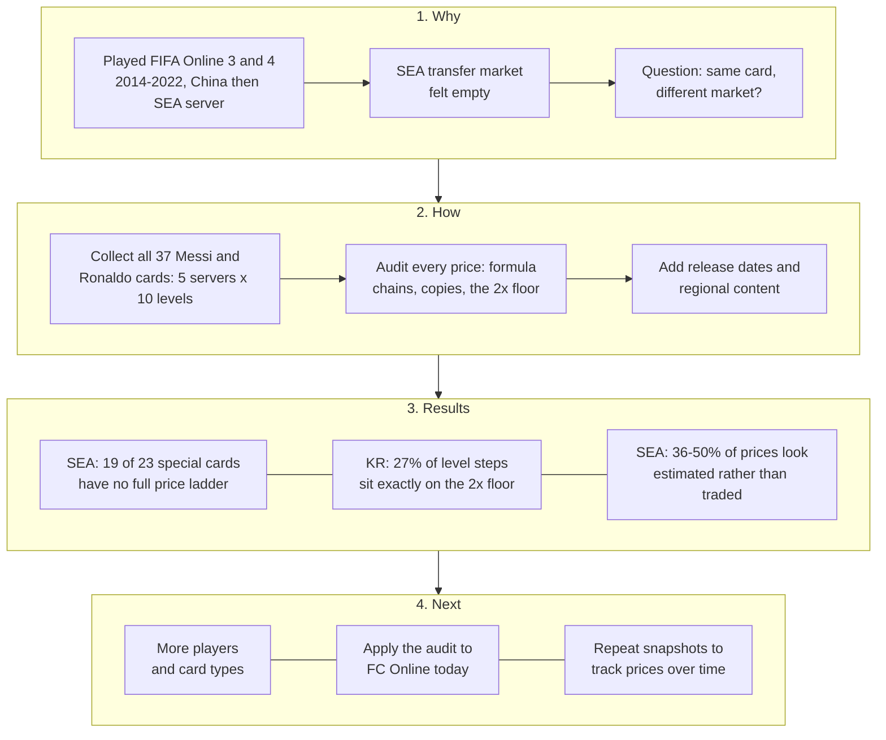
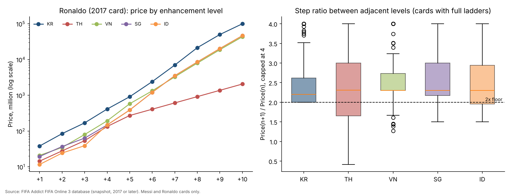

# Same Card, Different Market: An Audit of FIFA Online 3 Player-Card Prices in Korea and Southeast Asia

**Zhang Lin Si Cheng (Toni)**
Independent working paper, October 2026. Not peer reviewed.
Repository: [github.com/Shelikeit69/fo3-market-audit](https://github.com/Shelikeit69/fo3-market-audit)

---

## Abstract

FIFA Online 3 sold the same player cards in a large market, Korea, and in four smaller markets in Southeast Asia run by Garena. This paper asks how card prices were formed in each and what that implies for running a game economy in a small region. Using a fan-site snapshot of 1,105 prices for all 37 Messi and Ronaldo cards across five servers and ten enhancement levels, I apply a rule-based audit that flags prices with the signatures of formulas, copying or regulatory floors rather than trading. Three patterns emerge. First, 19 of 23 special cards have no full price ladder in Southeast Asia. Second, in Korea none of 333 level-to-level steps falls below the documented minimum of twice the previous level, and 27% sit exactly on it. Third, between 36% and 50% of Southeast Asia prices on fully priced cards look estimated rather than traded. The results are consistent with thin markets failing to form prices for many card types. I discuss what this suggests for release policy in small regions and state the limits of a single third-party snapshot.

**Keywords:** virtual economies; thin markets; price floors; data quality; live operations; FIFA Online 3

---

## 1. Introduction

### 1.1 Motivation

I played FIFA Online 3 and 4 from 2014 to 2022, first on the China server and then on Garena's Southeast Asia server. On the Southeast Asia server the transfer market often felt empty: few listings, odd prices and long waits. That experience raised a practical question for anyone running the same game in several regions: when a product works in a large home market, does it work the same way in a small one?

### 1.2 Research question

> The same player card was sold in a large market (Korea, run by Nexon) and in small markets (Thailand, Vietnam, Singapore/Malaysia and Indonesia, run by Garena). How was its price formed in each, and what does that suggest about copying Korea's live-operations approach into a smaller region?

The question breaks into three parts that the data can address:

1. **Coverage:** how many cards have no usable price in the small markets?
2. **Price formation:** among cards that do have prices, how many prices look traded and how many look estimated?
3. **Rules:** are prices in the large market set freely, or held by the game's rules?

### 1.3 Contribution

This is a small descriptive study, not a new method. Its contributions are modest: (a) a transparent, reproducible audit of a public third-party price source; (b) evidence that a documented trading rule binds in about a quarter of Korean price steps; and (c) a link between those findings and release decisions for small regional markets.

### 1.4 Roadmap



---

## 2. Related Work

**Virtual economies as economies.** Castronova [1] treated the online world of EverQuest as a national economy, estimating output, wages and a currency exchange rate from player surveys and auction listings. Two of his observations matter here. Prices paid by the game's own merchants act as a floor for item prices, and because items do not wear out, supply accumulates and the premium on new items fades. Lehdonvirta and Castronova [2] develop these ideas into a design framework covering currency sources and sinks, inflation and market design.

**Thin markets and player exit.** Drachen et al. [3] analysed about 2.9 million auction records from the browser game Glitch until it closed. As monthly players fell from 4,632 to 723, daily auctions fell sharply, and after the closure was announced price volatility rose and half of all items lost value. Their study is the closest analogue to a market with too few traders.

**Interventions and third-party data.** Hogan-Hennessy et al. [4] studied a transaction tax and an item sink in Old School RuneScape using daily prices collected by a third-party client used by about 75% of players. They report effects with confidence intervals and are explicit that the data do not cover the whole market and that the developer's aims were not published, so success cannot be judged. Their careful treatment of incomplete third-party data is the model for this paper's method.

**Gap.** These studies each look at one market. This paper compares the same goods across servers of one game, one large and several small, using a public fan-site source whose quality must itself be checked.

---

## 3. Background: FIFA Online 3

FIFA Online 3 was developed by EA and published by Nexon in Korea from December 2012, by Tencent in China from 2014 and by Garena in Thailand, Vietnam, Singapore/Malaysia and Indonesia from 2013 to 2014 [5, 6]. The Southeast Asia service closed on 30 June 2020 [7]; the Korean service closed in 2018 after FIFA Online 4 launched [6].

Players bought and sold player cards on an in-game transfer market using the game currency, EP. A card could be enhanced from +1 to +10 by combining copies, with success becoming less likely at higher levels [6]. Two rules from the community wiki [6] matter for this paper:

- **Price band:** each card traded within ±10% of a base price, and the base moved when many trades hit the upper or lower limit.
- **Enhancement floor:** a card one level higher could not be priced below twice the price of the level beneath it.

On refresh timing, my own recollection is that prices on the China server updated every 15 minutes. I did not observe this on the Southeast Asia server, and the wiki gives one to two hours for Korea [6], so the interval may have differed by region.

---

## 4. Data

**Source.** FIFA Addict, a fan site, publishes a FIFA Online 3 card database [8]. Each card page lists a price for ten enhancement levels on five servers: Korea (KR), Thailand (TH), Vietnam (VN), Singapore (SG) and Indonesia (ID). The site does not describe how prices were collected or how gaps were filled.

**Sample.** All cards of two players: Messi (18 cards) and Ronaldo (19 cards), 37 cards in total. I chose these players because they are among the most traded, so their markets should be the deepest available. Cards were grouped as *ordinary seasons* (yearly cards for 2006 to 2011 and 2017, 14 cards) and *special* cards (tournament, Champions League, World Best, Loyal Player, Captain and Continental Champion cards, 23 cards). Appendix B lists every card.

**Size.** 37 cards × 5 servers × 10 levels gives 1,850 possible prices, of which 1,105 are present.

**Timing.** The Korean prices include the 2017 season cards, which Korea released on 30 November 2017 [9], so they were recorded on or after that date. The site states that Korean prices were last updated "about 9 years ago" relative to October 2026. No update date is shown for the Southeast Asia prices.

**Collection and checks.** Pages were read one at a time in October 2026 and transcribed to CSV. As an accuracy check, the 50 prices for the Ronaldo 2017 card were compared with a screenshot of the same page; all 50 matched. The raw files are in `data/` (Appendix C).

**Release dates.** Korean release dates for six card types came from news reports and the community wiki [9, 10, 11]. Southeast Asia release dates were searched for in Vietnamese, Thai and English sources; only one could be found [12].

---

## 5. Method

Each price is compared with the price one level below it on the same card and server. A price is flagged when it shows one of the patterns in Table 1. Because the site rounds to 0.1 million, "exactly" allows one display step of rounding (100,000 EP, scaled by the multiplier). The code is in [`audit.py`](audit.py).

*Table 1. Audit flags*

| Flag | Rule | Reason |
|---|---|---|
| Formula chain | Two or more consecutive steps rise by exactly ×1.5, ×2.3 or ×3 | Traded prices do not repeat an exact multiplier |
| Floor binding | A step is exactly ×2.00 | The price sits on the minimum the rules allow |
| Cross-server copy | Two servers show the same price for the same card and level | Independent markets rarely match to the last digit |
| Price inversion | A higher level is cheaper than a lower one | Not possible in a working market |
| Lone price | A server shows a price for +1 only | Too little data to treat as a market |

A price is counted as **suspect** if it is a formula chain, a cross-server copy or a price inversion. Floor binding is reported separately because it reflects a real rule rather than missing data. The multipliers 1.5, 2.3 and 3 were not chosen in advance; they were the values that repeated in the data, which is a limitation discussed in Section 8.

---

## 6. Results



*Figure 1. Left: price by enhancement level for the Ronaldo 2017 card on each server. Right: distribution of step ratios for cards with full ladders; the dashed line marks the 2× floor.*

### 6.1 Coverage: small markets lack prices for special cards

All 14 ordinary season cards have full price ladders on every server. Of the 23 special cards, only 4 have full ladders in Southeast Asia (World Best and 2014 World Cup, for both players). Fifteen show a single Thailand price for +1 and nothing else; in 7 of those 15 the Thailand price is higher than the Korean price. Four show no Southeast Asia price at all.

### 6.2 Rules: a quarter of Korean steps sit on the floor

Across 333 level-to-level steps in Korea, none falls below 2×, and 91 (27%) sit exactly at 2.00×. The share is similar for ordinary cards (32 of 126, 25%) and special cards (59 of 207, 29%). Korean prices respond to trading, but often only as far as the floor allows.

### 6.3 Price formation: many small-market prices look estimated

*Table 2. Audit results for the 18 cards with full ladders on all servers (Korea: all 37 cards)*

| Server | Prices flagged as suspect | Steps below the 2× floor |
|---|---|---|
| KR | 0.5% | 0 of 333 |
| TH | 41.1% | 62 of 162 |
| VN | 36.1% | 9 of 162 |
| SG | 50.0% | 35 of 162 |
| ID | 46.7% | 39 of 162 |

The same sequence of values also appears on different cards. For example, 678.5M, 1,560.5M, 3,589.1M and 8,254.9M (each ×2.3 the last) appear on Ronaldo's 2007 card and again, one level higher, on his 2009 card. Singapore and Indonesia often show identical prices from the middle levels upward. Full per-cell flags are in `data/audit_cells.csv`.

### 6.4 Release timing and regional content

*Table 3. Release dates found*

| Card type | Korea release | Southeast Asia | Full SEA prices in sample? |
|---|---|---|---|
| 2014 World Cup | 22 May 2014 [10] | Already listed in Vietnam by 30 May 2014 [12] | Yes |
| World Legend | 25 Nov 2014 [9] | Not found | Not sampled |
| 2010 World Cup | 1 Jan 2016 [9] | Not found | No |
| Euro / Copa 2016 | 1 Jun 2016 [9] | Not found | No |
| Loyal Player | Jan 2017 [9] | Not found | No |
| Continental Champion | 31 Aug 2017 [11] | Not found | No |
| 2017 season | 30 Nov 2017 [9] | Not found | Yes |

Garena also added content of its own: three Malaysian football figures in July 2016 [13], and a Vietnam national team in the 2014 World Cup mode [14]. That report names VED, not Garena, as the Vietnam operator, which conflicts with other sources [5].

---

## 7. Discussion

**What the results mean.** The three findings fit one account. With few traders, many card types in Southeast Asia never formed a market, so the price source either shows nothing or fills the gap with a formula or a copy from a neighbouring server. In Korea, where trading was deep, prices did form, but the game's floor rule still fixed about a quarter of them. Glitch showed the same thinning over time as players left [3]; FIFA Online 3 shows it across regions at one moment.

**What this suggests for a small market.** The following are recommendations drawn from the findings, not tested results:

1. **Release fewer card types.** Each new type divides a small player base's trades further. In this sample, the only card types with full Southeast Asia price ladders were the ordinary seasons, World Best and the 2014 World Cup set.
2. **Keep major tournaments in step with Korea.** The 2014 World Cup set reached Vietnam within about a week and has full price ladders in this sample; interest in a tournament peaks at the same time everywhere.
3. **Pool liquidity.** A shared Southeast Asia market would put more buyers and sellers behind each card than four separate ones.
4. **Spend localisation effort on local content,** as Garena did with Malaysian legends, rather than on matching every Korean release.

A related point from my own experience: on the China server, Tencent ran FIFA Online 3 and FIFA Online 4 side by side, so players were split across two games and many stayed on FIFA Online 3. That is the same thinning effect at a larger scale.

---

## 8. Limitations

1. **One snapshot.** The data show a single point in time, with no trading volume and no Southeast Asia update dates. Changes over time cannot be studied.
2. **Two players.** Messi and Ronaldo are among the most traded cards, so less popular cards are likely to look thinner still. The results should not be read as averages for the whole market.
3. **Unknown source method.** FIFA Addict does not document how prices were gathered or filled. The flags identify patterns, not proof of how a price was produced.
4. **Data-driven thresholds.** The multipliers used to detect formula chains were found in the same data they are used to flag. A larger sample should test them on cards not used to choose them.
5. **Secondary sources for rules.** The price band and floor rules come from a community wiki and my own memory, not from official documents.
6. **Manual transcription.** Prices were read page by page. One card was checked in full against a screenshot, but transcription errors elsewhere cannot be ruled out.

---

## 9. Conclusion and Future Work

In this sample, the same FIFA Online 3 cards behaved differently in a large and a small market. Korean prices formed through trading but were often held at the rule-based floor; many Southeast Asia prices either did not exist or show the signs of being estimated. For a publisher running one game in regions of very different size, this points towards a release policy that concentrates trading in fewer card types and shares liquidity across small markets.

Next steps:

1. **Widen the sample** to more players and card types, including less popular cards.
2. **Apply the same audit to FC Online,** the game's current version, using today's prices.
3. **Take repeated snapshots** so prices can be tracked over time.

---

## References

[1] Castronova, E. (2001). *Virtual Worlds: A First-Hand Account of Market and Society on the Cyberian Frontier* (CESifo Working Paper No. 618). CESifo. https://www.cesifo.org/en/publications/2001/working-paper/virtual-worlds-first-hand-account-market-and-society-cyberian

[2] Lehdonvirta, V., & Castronova, E. (2014). *Virtual Economies: Design and Analysis*. MIT Press.

[3] Drachen, A., Riley, J., Baskin, S., & Klabjan, D. (2016). Going out of business: Auction house behavior in the massively multi-player online game Glitch. *arXiv preprint* arXiv:1603.07610. https://arxiv.org/abs/1603.07610

[4] Hogan-Hennessy, S., Xenopoulos, P., & Silva, C. (2022). Market interventions in a large-scale virtual economy. *arXiv preprint* arXiv:2210.07970. https://arxiv.org/abs/2210.07970

[5] Wikipedia. (n.d.). *FIFA Online 3*. Retrieved October 2026, from https://en.wikipedia.org/wiki/FIFA_Online_3

[6] Namu Wiki. (n.d.). *피파 온라인 3* [FIFA Online 3]. Retrieved October 2026, from https://en.namu.wiki/w/%ED%94%BC%ED%8C%8C%20%EC%98%A8%EB%9D%BC%EC%9D%B8%203

[7] Aksiz. (2020). *Pelayan FIFA Online 3 untuk Asia Tenggara akan ditutup Jun ini* [FIFA Online 3 servers for Southeast Asia will close this June]. Retrieved October 2026, from https://aksiz.com/202041243/

[8] FIFA Addict. (n.d.). *FIFA Online 3 player database*. Retrieved October 2026, from https://cn.fifaaddict.com/fo3db.php

[9] Namu Wiki. (n.d.). *피파 온라인 3/선수 카드* [FIFA Online 3/Player cards]. Retrieved October 2026, from https://namu.wiki/w/%ED%94%BC%ED%8C%8C%20%EC%98%A8%EB%9D%BC%EC%9D%B8%203/%EC%84%A0%EC%88%98%20%EC%B9%B4%EB%93%9C

[10] Heo, J. (2014, May 23). [이적 시장 분석] 피파온라인3 월드컵 카드의 초기 시세 분석 [Transfer market analysis: early prices of FIFA Online 3 World Cup cards]. *GameMeca*. https://www.gamemeca.com/view.php?gid=493430

[11] GameMeca. (2017, August 31). 피파온라인3, 신규레전드와 시즌 카드 '컨티넨탈 챔피언' 업데이트 [FIFA Online 3 adds new legends and Continental Champion cards]. https://www.gamemeca.com/view.php?gid=1383072

[12] Việt Giải Trí. (2014, May 30). Thẻ cầu thủ mùa World Cup: Xổ số trong FIFA Online 3 [World Cup player cards: a lottery in FIFA Online 3]. https://vietgiaitri.com/the-cau-thu-mua-world-cup-xo-so-trong-fifa-online-3-20140530i1406710/

[13] Lowyat.NET. (2016, July 1). Malaysian football legends join FIFA Online 3. https://lowyat.net/2016/108767/malaysian-football-legends-join-fifa-online-3-were-giving-away-codes-to-celebrate-the-occasion

[14] VietNamNet. (2014, May 28). Đội tuyển Việt Nam có mặt tại World Cup 2014 trong FIFA Online 3 [Vietnam national team appears in FIFA Online 3's World Cup 2014]. https://vietnamnet.vn/doi-tuyen-viet-nam-co-mat-tai-world-cup-2014-trong-fifa-online-3-i385728.html

---

## Appendix A. Audit settings

| Setting | Value | Note |
|---|---|---|
| Rounding tolerance | 100,000 EP × multiplier | The site shows prices to 0.1 million |
| Formula multipliers | 1.5, 2.3, 3.0 | Must repeat on at least two consecutive steps |
| Floor multiplier | 2.0 | Reported separately, not counted as suspect |
| Cross-card repeat | Price ≥ 100 million EP on two or more cards | Lower round numbers repeat by chance; reported but not counted as suspect |
| Ordinary seasons | 06, 07, 08, 09, 10, 11, 17 | All other codes treated as special |

## Appendix B. Card list

KR +1 price is the Korean price at enhancement level +1. "SEA cells flagged" is the share of Southeast Asia prices on that card counted as suspect, shown only for cards with full ladders.

| Player | Code | Card type | Card ID | KR +1 price (M) | SEA coverage | SEA cells flagged | KR release (if found) |
|---|---|---|---|---|---|---|---|
| Ronaldo | XI | World Best | 91020801 | 1,895.1 | Full on all 5 | 75% |  |
| Ronaldo | CC | Continental Champion | 24020801 | 582.2 | Korea only |  | 31 Aug 2017 |
| Ronaldo | LP | Loyal Player | 23020801 | 313.4 | Korea only |  | Jan 2017 |
| Ronaldo | CP | Captain Player | 22020801 | 275.2 | Korea + TH +1 only |  |  |
| Ronaldo | 16EC | 2016 Euro Copa | 35020801 | 116.5 | Korea + TH +1 only |  | 1 Jun 2016 |
| Ronaldo | 14T | Team of the Season 2014 | 53020801 | 33.0 | Korea + TH +1 only |  |  |
| Ronaldo | 06U | UEFA Champions League 2006 | 63020801 | 25.4 | Korea + TH +1 only |  |  |
| Ronaldo | 10U | UEFA Champions League 2010 | 69020801 | 19.9 | Korea + TH +1 only |  |  |
| Ronaldo | 14WC | World Cup 2014 | 77020801 | 26.7 | Full on all 5 | 42% | 22 May 2014 |
| Ronaldo | 11 | Season 2011 | 11020801 | 21.9 | Full on all 5 | 52% |  |
| Ronaldo | 10WC | World Cup 2010 | 47020801 | 6.6 | Korea + TH +1 only |  | 1 Jan 2016 |
| Ronaldo | 08 | Season 2008 | 8020801 | 25.0 | Full on all 5 | 40% |  |
| Ronaldo | 10 | Season 2010 | 10020801 | 10.5 | Full on all 5 | 32% |  |
| Ronaldo | 07 | Season 2007 | 7020801 | 14.9 | Full on all 5 | 45% |  |
| Ronaldo | 09 | Season 2009 | 9020801 | 9.2 | Full on all 5 | 40% |  |
| Ronaldo | 06WC | World Cup 2006 | 65020801 | 6.2 | Korea + TH +1 only |  |  |
| Ronaldo | 06 | Season 2006 | 6020801 | 9.1 | Full on all 5 | 15% |  |
| Ronaldo | 08E | UEFA Euro 2008 | 67020801 | 4.0 | Korea + TH +1 only |  |  |
| Ronaldo | 17 | Season 2017 | 88020801 | 38.1 | Full on all 5 | 48% | 30 Nov 2017 |
| Messi | XI | World Best | 91158023 | 637.5 | Full on all 5 | 75% |  |
| Messi | LP | Loyal Player | 23158023 | 129.5 | Korea only |  | Jan 2017 |
| Messi | CP | Captain Player | 22158023 | 152.9 | Korea + TH +1 only |  |  |
| Messi | CC | Continental Champion | 24158023 | 223.3 | Korea only |  | 31 Aug 2017 |
| Messi | 16EC | 2016 Euro Copa | 35158023 | 90.1 | Korea + TH +1 only |  | 1 Jun 2016 |
| Messi | 14T | Team of the Season 2014 | 53158023 | 26.6 | Korea + TH +1 only |  |  |
| Messi | 10U | UEFA Champions League 2010 | 69158023 | 45.9 | Korea + TH +1 only |  |  |
| Messi | 14WC | World Cup 2014 | 77158023 | 58.4 | Full on all 5 | 57% | 22 May 2014 |
| Messi | 17 | Season 2017 | 88158023 | 15.6 | Full on all 5 | 52% | 30 Nov 2017 |
| Messi | 11 | Season 2011 | 11158023 | 20.5 | Full on all 5 | 45% |  |
| Messi | 10 | Season 2010 | 10158023 | 13.9 | Full on all 5 | 32% |  |
| Messi | 09 | Season 2009 | 9158023 | 16.4 | Full on all 5 | 42% |  |
| Messi | 06U | UEFA Champions League 2006 | 63158023 | 4.1 | Korea + TH +1 only |  |  |
| Messi | 08 | Season 2008 | 8158023 | 7.1 | Full on all 5 | 40% |  |
| Messi | 10WC | World Cup 2010 | 47158023 | 8.5 | Korea + TH +1 only |  | 1 Jan 2016 |
| Messi | 06WC | World Cup 2006 | 65158023 | 5.4 | Korea + TH +1 only |  |  |
| Messi | 07 | Season 2007 | 7158023 | 6.1 | Full on all 5 | 25% |  |
| Messi | 06 | Season 2006 | 6158023 | 6.0 | Full on all 5 | 22% |  |

## Appendix C. Data dictionary

`data/raw_messi.csv` and `data/raw_ronaldo.csv` (one row per card and enhancement level):

| Column | Meaning |
|---|---|
| player | Messi or Ronaldo |
| card_id | FIFA Addict card ID; the leading digits identify the card type and the last six the player |
| season_code | Card type code as shown on the site |
| season_name | Card type name |
| row | Enhancement level, 1 to 10 |
| rating | Overall rating shown for that level |
| KR, TH, VN, SG, ID | Price in EP on each server; blank where the site shows none |

`data/audit_cells.csv` (one row per non-empty price) adds the previous level's price, the step ratio and each flag in Table 1.

## Appendix D. Reproducibility and disclosure

```
pip install -r requirements.txt
python audit.py     # prints Table 2 and the coverage counts; writes data/audit_cells.csv
python chart.py     # writes figures/price_ladders.png
```

The raw audit output is saved in [`figures/audit_output.txt`](figures/audit_output.txt).

**Use of AI tools.** I used an AI assistant (Claude) to help write code, search sources and draft text. I chose the research question, checked the data against the source and reviewed every figure and claim.

**Data and rights.** Price data belong to their original source and are included only as a small research sample. FIFA Online 3 was developed by EA; this project is not affiliated with EA, Nexon, Tencent, Garena or FIFA Addict. Code is released under the MIT License.
