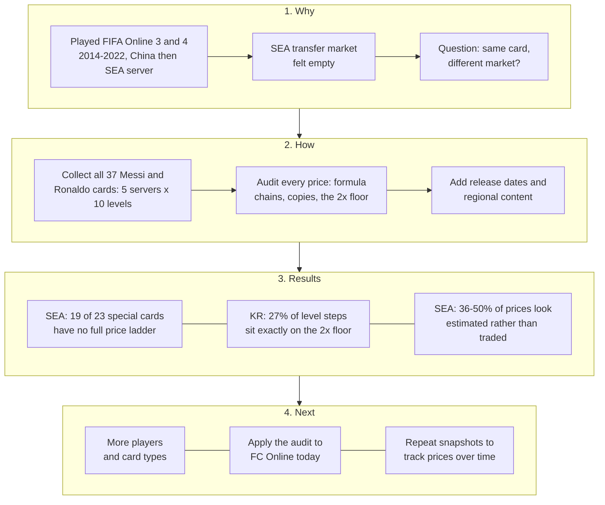

# Same Card, Different Market: FIFA Online 3 Prices in Korea and Southeast Asia

I played FIFA Online 3 and 4 from 2014 to 2022, first on the China server and then on Garena's Southeast Asia server. On the Southeast Asia server the transfer market often felt empty: few listings, odd prices, long waits. This project checks that impression against data.

**Question:** the same player card was sold in a large market (Korea, run by Nexon) and in small markets (Thailand, Vietnam, Singapore/Malaysia and Indonesia, run by Garena). How was its price formed in each, and what does that suggest about copying Korea's live-operations approach into a smaller region?

## Roadmap



## Data

- **Source:** the FIFA Online 3 database on [FIFA Addict](https://cn.fifaaddict.com/fo3db.php), a fan site. Each card page lists a price for 10 enhancement levels (+1 to +10) on five servers: Korea (KR), Thailand (TH), Vietnam (VN), Singapore (SG) and Indonesia (ID).
- **Sample:** every Messi card (18) and every Ronaldo card (19) on the site, 37 cards in total and 1,105 non-empty prices. Raw data: [`data/`](data/).
- **Date of the snapshot:** the Korea prices include the 2017 season cards, which Korea released on 30 November 2017, so they were recorded after that date. The site does not show when the Southeast Asia prices were updated.
- **Collection:** pages were read one by one in October 2026. As a check, the 50 prices for the Ronaldo 2017 card were compared with a screenshot of the same page, and all 50 matched.
- **Market rules (secondary sources):** according to [Namu Wiki](https://en.namu.wiki/w/%ED%94%BC%ED%8C%8C%20%EC%98%A8%EB%9D%BC%EC%9D%B8%203), each card traded within ±10% of a base price that moved with trading, and a card one level higher could not be priced below twice the level beneath it. From my own memory, prices on the China server (run by Tencent) refreshed every 15 minutes; I never checked this on the Southeast Asia server. Namu Wiki gives one to two hours for Korea, so the refresh interval may have differed by region and is unconfirmed.

## Method

[`audit.py`](audit.py) checks each price against its neighbours. It flags a price when:

| Flag | Rule | Why it matters |
|---|---|---|
| Formula chain | Two or more consecutive levels rise by exactly ×1.5, ×2.3 or ×3 | Traded prices do not repeat an exact multiplier |
| Floor binding | A level is exactly 2.00× the level below | The price sits on the minimum the rules allow |
| Cross-server copy | Two servers show the same price for the same card and level | Independent markets rarely match to the last digit |
| Price inversion | A higher level is cheaper than a lower one | Not possible in a working market |
| Lone price | A server shows a price for +1 only | Too little data to treat as a market |

"Exactly" allows for rounding: the site shows prices to the nearest 0.1 million.

## Findings


**1. Southeast Asia had almost no prices for special cards.** All 14 ordinary season cards (2006 to 2011 and 2017) have full price ladders on every server. Of the 23 special cards (World Cup, Champions League, Loyal Player and others), only 4 have full ladders in Southeast Asia. Fifteen show a single Thailand price for +1 and nothing else; in 7 of those 15 the Thailand price is higher than the Korea price. Four show no Southeast Asia price at all.

**2. In Korea, the rules set about a quarter of the prices.** Across 333 steps from one level to the next, none falls below 2×, and 91 (27%) sit exactly at 2.00×. The share is similar for ordinary cards (32 of 126) and special cards (59 of 207). Korea's prices respond to trading, but often only as far as the floor allows.

**3. Many Southeast Asia prices do not look like trades.** For the 18 cards with full ladders:

| Server | Prices flagged* | Steps below the 2× floor |
|---|---|---|
| KR | 0.5% | 0 of 333 |
| TH | 41.1% | 62 of 162 |
| VN | 36.1% | 9 of 162 |
| SG | 50.0% | 35 of 162 |
| ID | 46.7% | 39 of 162 |

\*Formula chain, cross-server copy or price inversion.

The same sequence of values also appears on different cards. For example, 678.5M, 1,560.5M, 3,589.1M and 8,254.9M (each ×2.3 the last) appear on Ronaldo's 2007 card and again, one level higher, on his 2009 card. Singapore and Indonesia often show identical prices from the middle levels upward. The site does not say how it fills gaps, so these patterns suggest, but do not prove, that many Southeast Asia prices were estimated rather than traded.

## Release timing

I looked for the dates each card type reached each region. Korea dates were available; Southeast Asia dates mostly were not.

| Card type | Korea release | Southeast Asia |
|---|---|---|
| 2014 World Cup | 22 May 2014 | Already listed in Vietnam by 30 May 2014 |
| World Legend | 25 Nov 2014 | Not found |
| 2010 World Cup | 1 Jan 2016 | Not found; no prices in this sample |
| Euro / Copa 2016 | 1 Jun 2016 | Not found; no prices in this sample |
| Loyal Player | Jan 2017 | Not found; no prices in this sample |
| Continental Champion | 31 Aug 2017 | Not found; no prices in this sample |
| 2017 season | 30 Nov 2017 | Not found; full prices in this sample |

Garena also added regional content of its own: three Malaysian football figures in July 2016, and a Vietnam national team in the 2014 World Cup mode (that report names VED, not Garena, as the Vietnam operator).

## What this suggests for a small market

These are recommendations drawn from the findings, not tested results.

1. **Release fewer card types.** Every new type divides a small player base's trades further. In this sample, the only card types with full Southeast Asia price ladders were the ordinary seasons, World Best and the 2014 World Cup set.
2. **Keep major tournaments in step with Korea.** The 2014 World Cup set reached Vietnam within about a week and has full price ladders in this sample; interest in a tournament peaks at the same time everywhere.
3. **Pool liquidity.** A shared Southeast Asia market would put more buyers and sellers behind each card than four separate ones.
4. **Spend localisation effort on local content,** as Garena did with Malaysian legends, rather than on matching every Korean release.

A related point from my own experience: on the China server, Tencent ran FIFA Online 3 and FIFA Online 4 side by side, so players were split across two games and many stayed on FIFA Online 3. That is the same thinning effect at a larger scale.

## Next steps

1. **Widen the sample** to more players and card types, including less popular cards.
2. **Apply the same audit to FC Online,** the game's current version, using today's prices.
3. **Take repeated snapshots** so prices can be tracked over time instead of at a single point.

## Limitations

- One snapshot, with no trading volume and no Southeast Asia update dates.
- Two players only. Messi and Ronaldo are among the most traded cards, so less popular cards are likely to look thinner still.
- FIFA Addict does not document its method. The flags identify patterns, not proof of how a price was produced.
- The rule details come from a community wiki and my memory, not from official documents.

## Background reading

- Castronova, E. (2001). [Virtual Worlds: A First-Hand Account of Market and Society on the Cyberian Frontier](https://www.cesifo.org/en/publications/2001/working-paper/virtual-worlds-first-hand-account-market-and-society-cyberian). CESifo Working Paper 618.
- Drachen, A. et al. [Going Out of Business: Auction House Behavior in the Massively Multi-Player Online Game Glitch](https://arxiv.org/abs/1603.07610). arXiv 1603.07610.
- Hogan-Hennessy, S., Xenopoulos, P. and Silva, C. (2022). [Market Interventions in a Large-Scale Virtual Economy](https://arxiv.org/abs/2210.07970). arXiv 2210.07970.

Release dates: [GameMeca, 23 May 2014](https://www.gamemeca.com/view.php?gid=493430); [GameMeca, 31 Aug 2017](https://www.gamemeca.com/view.php?gid=1383072); [Namu Wiki, player cards](https://namu.wiki/w/%ED%94%BC%ED%8C%8C%20%EC%98%A8%EB%9D%BC%EC%9D%B8%203/%EC%84%A0%EC%88%98%20%EC%B9%B4%EB%93%9C); [Việt Giải Trí, 30 May 2014](https://vietgiaitri.com/the-cau-thu-mua-world-cup-xo-so-trong-fifa-online-3-20140530i1406710/); [VietNamNet, 28 May 2014](https://vietnamnet.vn/doi-tuyen-viet-nam-co-mat-tai-world-cup-2014-trong-fifa-online-3-i385728.html); [Lowyat, 1 Jul 2016](https://lowyat.net/2016/108767/malaysian-football-legends-join-fifa-online-3-were-giving-away-codes-to-celebrate-the-occasion).

## Run it

```
pip install -r requirements.txt
python audit.py     # prints the tables above and writes data/audit_cells.csv
python chart.py     # writes figures/price_ladders.png
```

## Notes

Built with help from an AI coding assistant; I chose the question, checked the data against the source and reviewed every figure. Price data belongs to its original source and is included only as a small research sample. FIFA Online 3 was developed by EA and is not affiliated with this project. Code is released under the MIT License.
