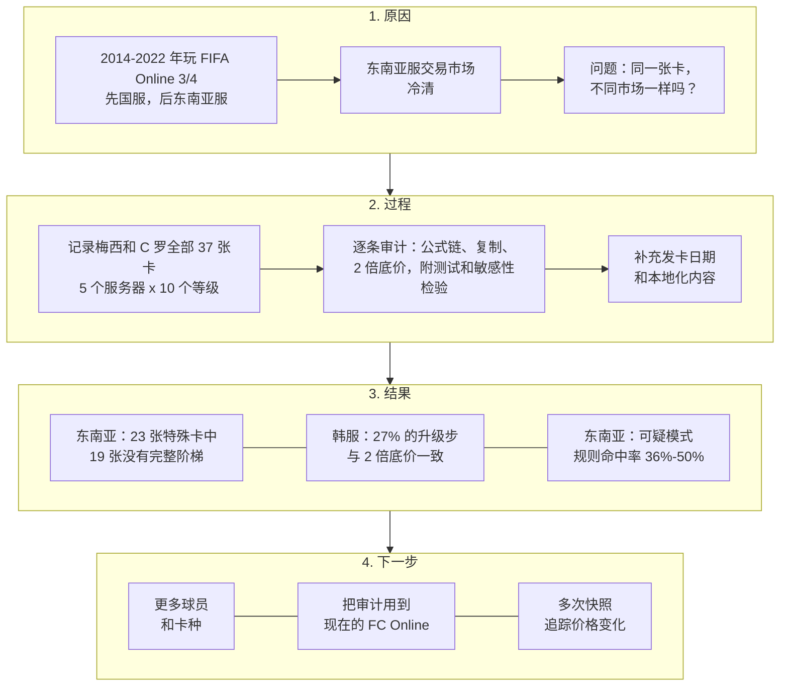

# 同一张卡，不同的记录：FIFA Online 3 韩服与东南亚服第三方价格审计

**Zhang Lin Si Cheng（Toni）**
独立工作论文，第 2 版，2026 年 10 月。未经同行评审。
仓库：[github.com/Shelikeit69/fo3-market-audit](https://github.com/Shelikeit69/fo3-market-audit)
[English version](README.md)

[](https://github.com/Shelikeit69/fo3-market-audit/actions/workflows/tests.yml)

> 本文是英文版的中文译本，两者如有出入，以英文版为准。

---

## 摘要

FIFA Online 3 在韩国（Nexon 运营，市场大）和东南亚四个服务器（Garena 运营，市场小）出售同样的球员卡。一个球迷网站至今仍保留着每张卡在每个服务器、每个强化等级上的一条价格记录。本文想弄清两件事：这些记录能说明各地区价格的什么情况，以及它们能不能用来判断市场当年是怎么运作的。

样本是梅西和 C 罗的全部 37 张卡，共 1,105 条价格记录。我用一套带测试的规则逐条审计，在给定的舍入容差内，标出三类价格：符合固定倍数的、在不同服务器之间完全相同的、以及恰好落在游戏底价规则上的。

结果有三点。第一，23 张特殊卡里有 19 张在东南亚服没有完整的价格阶梯。第二，韩服 333 个相邻等级的升级步里，没有一步低于规则规定的"上一级的 2 倍"，有 27% 在容差内恰好等于 2 倍。第三，在五个服务器都有完整阶梯的 18 张卡上，东南亚服的"可疑模式规则命中率"（公式链、跨服复制或价格倒挂）在 36% 到 50% 之间，同样这些卡在韩服是 0%。

这些是第三方记录里的模式，不是交易的直接证据。成交稀少是一种能解释它们的原因，但网站自行填补空缺、各服采集时间不同、某些卡在当地根本没发行，同样说得通。文中列出了每种解释各自需要什么证据，并把由此得出的运营建议明确当作待检验的假设。

**关键词：** 虚拟经济；薄市场；价格下限；数据质量；游戏运营；FIFA Online 3

---

## 1. 引言

### 1.1 研究动机

2014 到 2022 年我一直在玩 FIFA Online 3 和 4，先在国服，后来到了 Garena 的东南亚服。东南亚服的交易市场常常冷清：挂单少，价格怪，买卖要等很久。这让我想到一个运营问题：一款游戏在多个地区运营时，在大市场行得通的东西，放到小市场还一样吗？

### 1.2 研究问题

> 同一张球员卡，既在大市场（韩国）出售，也在小市场（泰国、越南、新马、印尼）出售。现存的价格记录在各地区呈现出什么样子？它们在多大程度上能支持关于价格形成、以及把韩服运营方法搬到小地区的结论？

数据能直接回答的有三个子问题：

1. **覆盖：** 有多少张卡在东南亚服没有可用的价格？
2. **模式：** 在记录完整的卡里，有多少价格呈现可疑模式（公式、复制或倒挂），而不是自然波动？
3. **规则：** 韩服的升级步有多少与游戏规定的"上一级 2 倍"底价一致？

这些模式是不是成交稀少造成的，是第四个问题。单靠这份数据回答不了，第 7 节把它作为假设来讨论。

### 1.3 贡献

这是一项小型描述性研究，不是新方法。它提供三样东西：一套透明、经过测试、可以复现的第三方价格记录审计；韩服约四分之一的升级步与成文交易规则一致的证据；以及把这些发现和小地区发卡决策联系起来、可以检验的几条假设。

### 1.4 路线图



---

## 2. 相关研究

**把虚拟世界当作经济体。** Castronova [1] 把 EverQuest 的游戏世界当成一个国家来核算，用玩家问卷和拍卖记录估算了产出、工资和货币汇率。他有两个观察和本文有关：游戏里 NPC 商人的收购价构成了物品价格的下限；物品不会损耗，供给不断累积，新物品的溢价会逐渐消失。Lehdonvirta 和 Castronova [2] 在此基础上整理出一套游戏经济的设计框架，涵盖货币的投放与回收、通胀和市场设计。

**薄市场与玩家流失。** Drachen 等 [3] 分析了浏览器游戏 Glitch 停服前约 290 万条拍卖记录。月活玩家从 4,632 人降到 723 人，日均拍卖量随之大幅下降；宣布停服后价格波动加大，一半物品贬值。这是和"交易者太少的市场"最接近的参照。

**市场干预与第三方数据。** Hogan-Hennessy 等 [4] 研究了 Old School RuneScape 的交易税和物品回收机制，数据来自约 75% 玩家使用的第三方客户端。他们给出带置信区间的效果估计，并明确说明数据不覆盖整个市场、开发商也没公布政策目标，所以无法判断干预是否成功。本文处理不完整第三方数据的方式，以这篇为样板。

**研究空白。** 上面几项研究各自只看一个市场。本文比较的是同一款游戏、同样的商品在一个大服和几个小服上的情况，而数据来自球迷网站，必须先检查数据本身的质量，才能谈别的。

---

## 3. 背景：FIFA Online 3

FIFA Online 3 由 EA 开发。韩服由 Nexon 从 2012 年 12 月开始运营，国服由腾讯从 2014 年开始运营，泰国、越南、新马和印尼由 Garena 在 2013 到 2014 年间陆续上线 [5, 6]。东南亚服于 2020 年 6 月 30 日关闭 [7]；韩服在 FIFA Online 4 上线后于 2018 年关闭 [6]。

玩家在游戏内的交易市场用游戏币 EP 买卖球员卡。同一张卡的多张复本可以合成强化，从 +1 升到 +10，等级越高越难成功 [6]。社区维基 [6] 记载的两条规则和本文有关：

- **价格区间：** 每张卡只能在基准价上下 10% 的范围内交易；大量成交触及上限或下限时，基准价随之移动。
- **强化底价：** 高一级的卡，价格不能低于低一级的 2 倍。

关于价格刷新频率，我记得国服是每 15 分钟刷新一次。东南亚服我没留意过，维基记载的韩服是 1 到 2 小时 [6]，所以各地区可能并不相同。

---

## 4. 数据

**来源。** 球迷网站 FIFA Addict 有一个 FIFA Online 3 的卡片数据库 [8]。每张卡的页面列出 10 个强化等级在 5 个服务器上的价格：韩国（KR）、泰国（TH）、越南（VN）、新加坡（SG）和印尼（ID）。网站没有说明价格是怎么采集的、各服多久更新一次，也没说明缺失的价格怎么处理。

**样本。** 两名球员的全部卡片：梅西 18 张、C 罗 19 张，共 37 张。选这两人，是因为他们的卡交易最多，记录理应最完整。卡片分为两组：普通赛季卡（2006 到 2011 年和 2017 年的年度卡，14 张）和特殊卡（大赛卡、欧冠卡、世界最佳、忠诚球员、队长和洲际冠军卡，23 张）。附录 B 列出每张卡及其原始页面链接。

**规模。** 37 张卡 × 5 个服务器 × 10 个等级，理论上有 1,850 个价格，实际有 1,105 个。

**两个不同的日期。** 采集日期是我读取页面的时间，即 2026 年 10 月。价格日期是网站记录每个价格的时间，页面上没有逐条显示。记录里有 2017 赛季卡，韩服于 2017 年 11 月 30 日发行这批卡 [9]，所以数据库里至少有一部分记录是在这一天或之后加入的。这只给 2017 赛季卡定了一个时间下限：旧卡的价格可能记录得更早，之后再没更新。网站说韩服价格"大约 9 年前"更新，但没说是哪些价格。东南亚服的价格没有任何日期，可能和韩服不是同一时间采集的。

**采集与核对。** 我逐页读取页面，转录成 CSV。为了核对准确性，我把 C 罗 2017 卡的 50 个价格和同一页面的截图逐一比对，全部一致。其他页面没有存档，读者如果要核对某个价格，只能打开附录 B 里的实时页面，而页面内容可能会变。

**发卡日期。** 六类卡的韩服发行日期来自新闻报道和社区维基 [9, 10, 11]。东南亚服的发行日期，我用越南语、泰语和英语都检索过，只找到一条 [12]。

---

## 5. 方法

### 5.1 升级步与价格阶梯

**升级步**指同一张卡、同一服务器上，某一级价格与低一级价格的比较。只比较相邻等级：如果 +2 缺失，+3 不会拿去和 +1 比。一张卡在一个服务器上的价格构成一条**阶梯**：+1 到 +10 每级各出现一次，叫"完整"；只有 +1，叫"孤立"；其余叫"部分"。

### 5.2 审计标记

*表 1. 审计标记*

| 标记 | 规则 | 理由 |
|---|---|---|
| 公式链 | 两个相邻升级步在舍入容差内以同一倍数上涨（×1.5、×2.3 或 ×3） | 自然波动的价格很少反复出现同一个精确倍数 |
| 底价吻合 | 某个升级步在舍入容差内等于 ×2.00 | 与规则允许的最低价一致 |
| 跨服复制 | 同一张卡、同一等级，两个或以上服务器价格完全相同 | 独立的记录很少精确到最后一位都相同 |
| 价格倒挂 | 高一级比低一级便宜 | 与底价规则矛盾 |
| 覆盖不足 | 阶梯是孤立或部分的 | 数据太少，无法判断模式 |

输出里有两个汇总标签，分开记录。**可疑模式**指公式链、跨服复制或价格倒挂中的任意一种。**覆盖不足**指阶梯不完整。底价吻合单独报告，因为它和成文规则一致，并不代表数据有缺口；吻合也不能说明规则真的约束了某笔成交。正文把带可疑模式的价格占比称为**规则命中率**：它衡量的是记录与这些规则吻合的频率，不是经过核实的"估算价格比例"。

### 5.3 舍入容差

网站显示的价格大多精确到 0.1 百万 EP。对于倍数为 *k* 的升级步，*价格 − k × 前值* 的舍入误差最多是 0.05M + *k* × 0.05M，不超过 0.1M × *k*。因此默认容差取每单位倍数 100,000 EP。小额价格有时显示得更精确，对它们来说这个容差偏宽。如果一个升级步同时落在两个倍数的容差内，取误差（按倍数归一化，即 |价格 − k × 前值| ÷ k）更小的那个。第 6.4 节展示结果如何随容差变化。

1.5、2.3、3 这三个倍数不是事先设定的，而是在数据里反复出现的数值。第 8 节把这一点列为局限。

### 5.4 软件与测试

函数在 [`fo3audit.py`](fo3audit.py)，报告在 [`audit.py`](audit.py)。数据使用前先检查：必需的列都要在；每张卡的每个等级只出现一次；等级必须是 1 到 10 的整数；卡片信息不能缺失；每个价格必须是有限的正数。任何一项不通过，程序报错停止。[`tests/`](tests/) 里有 19 个自动测试，覆盖已发布的数字、等级缺口、错误输入、公式链、底价和阶梯状态。每次推送代码，GitHub Actions 都会运行这些测试，并检查提交的输出能否逐字复现。

---

## 6. 结果


*图 1. 左：C 罗 2017 卡在各服务器上逐级的价格记录。右：完整阶梯上的升级倍率，对数坐标，没有截断；虚线是 2 倍底价。有 42 个升级步的倍率大于 4。*

### 6.1 覆盖：东南亚服缺少特殊卡的记录

14 张普通赛季卡在所有服务器上都有完整阶梯。23 张特殊卡里，只有 4 张在东南亚服有完整阶梯（两人的世界最佳卡和 2014 世界杯卡）。15 张只有泰服 +1 的一个价格，其余全无；这 15 个价格里有 7 个比韩服还高。另有 4 张在东南亚服完全没有价格。每一张特殊卡在韩服都有完整阶梯。

### 6.2 规则：韩服约四分之一的升级步与底价一致

韩服共 333 个升级步，没有一步低于 2 倍，有 91 步（27%）在舍入容差内恰好等于 2 倍。普通卡（126 步中 32 步，25%）和特殊卡（207 步中 59 步，29%）的比例相近。韩服记录与维基描述的底价规则一致，但这条规则在这些等级上有没有真正约束成交，数据里看不出来。

### 6.3 模式：东南亚服的记录大量呈现可疑模式

*表 2. 完整阶梯上的规则命中率（带可疑模式的价格占比）*

| 服务器 | 全部完整阶梯 | 五服都完整的同 18 张卡 | 低于 2 倍底价的升级步 |
|---|---|---|---|
| KR | 0.5%（370 个中 2 个） | 0.0%（180 个中 0 个） | 333 步中 0 步 |
| TH | 41.1% | 41.1% | 162 步中 62 步 |
| VN | 36.1% | 36.1% | 162 步中 9 步 |
| SG | 50.0% | 50.0% | 162 步中 35 步 |
| ID | 46.7% | 46.7% | 162 步中 39 步 |

韩服 37 张卡都有完整阶梯，其他服务器只有 18 张。中间一列是在同样的卡上比较。

同一串数值还会出现在不同的卡上。比如 678.5M、1,560.5M、3,589.1M、8,254.9M（每个都是前一个的 2.3 倍）出现在 C 罗的 2007 卡上，又在他的 2009 卡上高一个等级的位置出现一次。新加坡和印尼从中间等级往上，价格经常完全相同。每条价格的标记结果见 `data/audit_cells.csv`。

### 6.4 对舍入容差的敏感性

*表 3. 不同舍入容差下的规则命中率（每单位倍数的 EP）*

| 容差 | KR | TH | VN | SG | ID |
|---|---|---|---|---|---|
| 0 | 0.0% | 31.1% | 10.6% | 44.4% | 38.3% |
| 50,000 | 0.0% | 40.0% | 35.6% | 48.9% | 45.0% |
| 100,000（默认） | 0.5% | 41.1% | 36.1% | 50.0% | 46.7% |
| 150,000 | 0.5% | 41.1% | 36.1% | 51.1% | 46.7% |

容差为 0 时，越南的公式链大多消失，因为价格经过舍入后就不可能精确相等。容差从 50,000 到 150,000，各服的命中率变化最多 2.2 个百分点（新加坡，从 48.9% 到 51.1%）。第 1 版的外部评审在 150,000 容差下算出越南为 37.2%；第 2 版是 36.1%，原因是一个升级步同时符合两个倍数时，现在按第 5.3 节的规则选择，而不是取第一个检查到的。四个东南亚服的排序在所有容差下都一样，韩服始终接近 0%。具体百分比取决于容差，和韩服的对比不受影响。

### 6.5 发卡时间与本地化内容

*表 4. 找到的发卡日期*

| 卡类 | 韩服发行 | 东南亚服 | 样本中东南亚服阶梯完整？ |
|---|---|---|---|
| 2014 世界杯 | 2014 年 5 月 22 日 [10] | 2014 年 5 月 30 日越南服已有挂单 [12] | 是 |
| 世界传奇 | 2014 年 11 月 25 日 [9] | 未找到 | 未抽样 |
| 2010 世界杯 | 2016 年 1 月 1 日 [9] | 未找到 | 否 |
| 2016 欧洲杯/美洲杯 | 2016 年 6 月 1 日 [9] | 未找到 | 否 |
| 忠诚球员 | 2017 年 1 月 [9] | 未找到 | 否 |
| 洲际冠军 | 2017 年 8 月 31 日 [11] | 未找到 | 否 |
| 2017 赛季 | 2017 年 11 月 30 日 [9] | 未找到 | 是 |

Garena 也做过自己的本地化内容：2016 年 7 月加入了三位马来西亚足球人物 [13]；2014 年世界杯模式加入了越南国家队 [14]。不过那篇报道写的越南服运营商是 VED，不是 Garena，和其他来源 [5] 不一致。

---

## 7. 讨论

### 7.1 记录说明了什么

审计确认了记录本身的三件事：东南亚服大多数特殊卡没有价格；韩服约四分之一的升级步与底价规则一致；东南亚服有相当大比例的价格呈现可疑模式。至于这些价格是怎么来的，审计回答不了。

### 7.2 可能的解释

*表 5. 与这些模式相符的解释，以及区分它们需要的证据*

| 解释 | 与哪些现象相符 | 什么证据能支持它 |
|---|---|---|
| **成交稀少。** 小市场交易太少，形成不了价格 | 特殊卡缺价；公式和复制模式 | 其他球迷网站出现同样的模式；任何留存来源显示东南亚服挂单更少 |
| **网站自行填补。** FIFA Addict 用固定倍数估算缺失的价格，或照搬邻近服务器 | 不同卡上重复出现 ×2.3 数列；新加坡和印尼相同 | 网站代码或人员确认有填补规则；不相关的球员也出现同样的倍数 |
| **采集时间不同。** 东南亚服价格采集于其他时间，或早已停止更新 | 东南亚服的缺口；没有更新日期 | 带日期的页面存档 |
| **卡未在当地发行。** 部分特殊卡在东南亚服根本不存在 | 特殊卡在东南亚服没有价格 | 东南亚服的官方更新公告 |

这几种解释可以同时成立。同一串 ×2.3 数列出现在两张不同的卡上，更像网站填补，而不像独立成交。但缺口之所以存在、需要填补，仍可能是因为成交稀少。这份数据分不开这两者。

### 7.3 小市场运营的假设

如果成交稀少是原因之一，这些发现指向下面几条运营假设。它们都没有经过检验，需要表 5 所列的那类证据。

1. **卡种少一些，交易就更集中。** 在本样本里，东南亚服阶梯完整的卡只有普通赛季卡、世界最佳卡和 2014 世界杯卡。
2. **大赛卡可以和韩服同步。** 2014 世界杯卡大约一周后就出现在越南服，样本中阶梯完整。
3. **合并区域市场能增加深度。** 东南亚统一成一个市场，每张卡背后的买家和卖家会比分成四个市场时多。
4. **本地化的重点可以放在本地内容上**，像 Garena 加入马来西亚传奇那样，而不是跟进韩服的每一次发卡。

还有一个来自我自己经历的观察：国服上，腾讯让 FIFA Online 3 和 FIFA Online 4 同时运营，玩家被分到两个游戏里，很多人留在了 OL3。如果成交稀少确实有影响，这种分流起的是同一个方向的作用。

---

## 8. 局限

1. **第三方记录，不是市场数据。** 审计描述的是 FIFA Addict 的记录，看不到成交、挂单和成交量。
2. **时间不明。** 价格没有日期。2017 赛季卡的存在只说明有部分记录是在 2017 年 11 月 30 日或之后加入的；旧卡价格可能更早，东南亚服价格也可能来自其他时间。
3. **只有两名球员。** 梅西和 C 罗的卡交易最多，结果不代表整个市场的平均情况。
4. **阈值来自数据本身。** 识别公式链用的倍数，是从被标记的同一批数据里找出来的。更大的样本应该在没有参与选定倍数的卡上检验它们。
5. **依赖舍入容差。** 具体比例随容差变化（表 3），与韩服的对比不变。
6. **规则来自二手资料。** 价格区间和底价规则来自社区维基和我的记忆，不是官方文件。
7. **人工转录，没有存档。** 价格是逐页读取的。只有一张卡与截图做了完整核对，其他页面没有存档。

---

## 9. 结论与后续工作

在这份记录里，同样的 FIFA Online 3 卡在韩服和东南亚服看起来不一样。韩服阶梯完整，约四分之一的升级步与成文底价一致。东南亚服大多数特殊卡没有价格，有价格的卡上，可疑模式规则命中率为 36% 到 50%。成交稀少是一种相符的解释，但网站自行填补、采集时间不同、卡未在当地发行，都可能产生同样的模式。第 7.3 节的建议应当作待检验的假设来看。

下一步：

1. **区分表 5 的几种解释**，先从带日期的页面存档和其他球迷网站入手。
2. **扩大样本**，纳入更多球员和卡种，并在没有参与选定倍数的卡上检验这些倍数。
3. **把同样的审计用到 FC Online**，也就是这款游戏的现行版本，用多次快照追踪价格随时间的变化。

---

## 版本记录

- **第 1 版**（2026 年 10 月 21 日）：首次发布。
- **第 2 版**（2026 年 10 月 21 日）：根据外部评审修订。结论限定在记录能说明的范围内，并补充替代解释（表 5）。升级步只比较相邻等级；明确定义完整阶梯；加入输入校验；跨服复制按不同服务器数量计数；拆分"可疑模式"和"覆盖不足"；加入倍数选择规则；加入测试和持续集成；补充敏感性分析（表 3）、同卡对比（表 2）和不截断的对数坐标图；锁定依赖版本；"底价约束"改称"底价吻合"；日期推断限定为 2017 赛季卡的时间下限。主要报告数值不变，第 1 版评审的敏感性检查除外（第 6.4 节）。
- **中文版**（2026 年 10 月 21 日）：根据第 2 版翻译。

---

## 参考文献

参考文献保留原文标题，非英文文献附英文译名。

[1] Castronova, E. (2001). *Virtual Worlds: A First-Hand Account of Market and Society on the Cyberian Frontier* (CESifo Working Paper No. 618). CESifo. https://www.cesifo.org/en/publications/2001/working-paper/virtual-worlds-first-hand-account-market-and-society-cyberian

[2] Lehdonvirta, V., & Castronova, E. (2014). *Virtual Economies: Design and Analysis*. MIT Press.

[3] Drachen, A., Riley, J., Baskin, S., & Klabjan, D. (2016). Going out of business: Auction house behavior in the massively multi-player online game Glitch. *arXiv preprint* arXiv:1603.07610. https://arxiv.org/abs/1603.07610

[4] Hogan-Hennessy, S., Xenopoulos, P., & Silva, C. (2022). Market interventions in a large-scale virtual economy. *arXiv preprint* arXiv:2210.07970. https://arxiv.org/abs/2210.07970

[5] Wikipedia. (n.d.). *FIFA Online 3*. Retrieved October 2026, from https://en.wikipedia.org/wiki/FIFA_Online_3

[6] Namu Wiki. (n.d.). *피파 온라인 3* [FIFA Online 3]. Retrieved October 2026, from https://en.namu.wiki/w/%ED%94%BC%ED%8C%8C%20%EC%98%A8%EB%9D%BC%EC%9D%B8%203

[7] Aksiz. (2020). *Pelayan FIFA Online 3 untuk Asia Tenggara akan ditutup Jun ini* [FIFA Online 3 servers for Southeast Asia will close this June]. Retrieved October 2026, from https://aksiz.com/202041243/

[8] FIFA Addict. (n.d.). *FIFA Online 3 player database*. Retrieved October 2026, from https://cn.fifaaddict.com/fo3db.php

[9] Namu Wiki. (n.d.). *피파 온라인 3/선수 카드* [FIFA Online 3/Player cards]. Retrieved October 2026, from https://namu.wiki/w/%ED%94%BC%ED%8C%8C%20%EC%98%A8%EB%9D%BC%EC%9D%B8%203/%EC%84%A0%EC%88%98%20%EC%B9%B4%EB%93%9C

[10] Heo, J. (2014, May 23). [이적 시장 분석] 피파온라인3 월드컵 카드의 초기 시세 분석 [Transfer market analysis: early prices of FIFA Online 3 World Cup cards]. *GameMeca*. https://www.gamemeca.com/view.php?gid=493430

[11] GameMeca. (2017, August 31). 피파온라인3, 신규레전드와 시즌 카드 '컨티넨탈 챔피언' 업데이트 [FIFA Online 3 adds new legends and Continental Champion cards]. https://www.gamemeca.com/view.php?gid=1383072

[12] Việt Giải Trí. (2014, May 30). Thẻ cầu thủ mùa World Cup: Xổ số trong FIFA Online 3 [World Cup player cards: a lottery in FIFA Online 3]. https://vietgiaitri.com/the-cau-thu-mua-world-cup-xo-so-trong-fifa-online-3-20140530i1406710/

[13] Lowyat.NET. (2016, July 1). Malaysian football legends join FIFA Online 3. https://lowyat.net/2016/108767/malaysian-football-legends-join-fifa-online-3-were-giving-away-codes-to-celebrate-the-occasion

[14] VietNamNet. (2014, May 28). Đội tuyển Việt Nam có mặt tại World Cup 2014 trong FIFA Online 3 [Vietnam national team appears in FIFA Online 3's World Cup 2014]. https://vietnamnet.vn/doi-tuyen-viet-nam-co-mat-tai-world-cup-2014-trong-fifa-online-3-i385728.html

---

## 附录 A. 审计参数

| 参数 | 取值 | 说明 |
|---|---|---|
| 舍入容差 | 100,000 EP × 倍数 | 推导见第 5.3 节；变化见表 3 |
| 公式倍数 | 1.5、2.3、3.0 | 两个相邻升级步倍数相同 |
| 底价倍数 | 2.0 | 单独报告，不算可疑模式 |
| 同时符合两个倍数时 | 取归一化误差更小者 | 归一化误差 = \|价格 − k × 前值\| ÷ k |
| 跨卡重复 | 价格 ≥ 1 亿 EP 且出现在两张或以上卡上 | 仅作参考 |
| 普通赛季 | 06、07、08、09、10、11、17 | 其他代码一律视为特殊卡 |

## 附录 B. 卡片清单

"韩服 +1 价格"是韩服 +1 等级的价格。"东南亚规则命中率"是该卡东南亚服价格中带可疑模式的比例，只对阶梯完整的卡列出。每个卡片 ID 链接到原始页面。

| 球员 | 代码 | 卡类（原名） | 卡片 ID（原始页面） | 韩服 +1 价格（百万 EP） | 东南亚阶梯 | 东南亚规则命中率 | 韩服发行（如找到） |
|---|---|---|---|---|---|---|---|
| 梅西 | XI | World Best | [91158023](https://cn.fifaaddict.com/fo3player.php?id=91158023) | 637.5 | 五服完整 | 75% |  |
| 梅西 | LP | Loyal Player | [23158023](https://cn.fifaaddict.com/fo3player.php?id=23158023) | 129.5 | 仅韩服 |  | 2017 年 1 月 |
| 梅西 | CP | Captain Player | [22158023](https://cn.fifaaddict.com/fo3player.php?id=22158023) | 152.9 | 仅泰服 +1 |  |  |
| 梅西 | CC | Continental Champion | [24158023](https://cn.fifaaddict.com/fo3player.php?id=24158023) | 223.3 | 仅韩服 |  | 2017 年 8 月 31 日 |
| 梅西 | 16EC | 2016 Euro Copa | [35158023](https://cn.fifaaddict.com/fo3player.php?id=35158023) | 90.1 | 仅泰服 +1 |  | 2016 年 6 月 1 日 |
| 梅西 | 14T | Team of the Season 2014 | [53158023](https://cn.fifaaddict.com/fo3player.php?id=53158023) | 26.6 | 仅泰服 +1 |  |  |
| 梅西 | 10U | UEFA Champions League 2010 | [69158023](https://cn.fifaaddict.com/fo3player.php?id=69158023) | 45.9 | 仅泰服 +1 |  |  |
| 梅西 | 14WC | World Cup 2014 | [77158023](https://cn.fifaaddict.com/fo3player.php?id=77158023) | 58.4 | 五服完整 | 57% | 2014 年 5 月 22 日 |
| 梅西 | 17 | Season 2017 | [88158023](https://cn.fifaaddict.com/fo3player.php?id=88158023) | 15.6 | 五服完整 | 52% | 2017 年 11 月 30 日 |
| 梅西 | 11 | Season 2011 | [11158023](https://cn.fifaaddict.com/fo3player.php?id=11158023) | 20.5 | 五服完整 | 45% |  |
| 梅西 | 10 | Season 2010 | [10158023](https://cn.fifaaddict.com/fo3player.php?id=10158023) | 13.9 | 五服完整 | 32% |  |
| 梅西 | 09 | Season 2009 | [9158023](https://cn.fifaaddict.com/fo3player.php?id=9158023) | 16.4 | 五服完整 | 42% |  |
| 梅西 | 06U | UEFA Champions League 2006 | [63158023](https://cn.fifaaddict.com/fo3player.php?id=63158023) | 4.1 | 仅泰服 +1 |  |  |
| 梅西 | 08 | Season 2008 | [8158023](https://cn.fifaaddict.com/fo3player.php?id=8158023) | 7.1 | 五服完整 | 40% |  |
| 梅西 | 10WC | World Cup 2010 | [47158023](https://cn.fifaaddict.com/fo3player.php?id=47158023) | 8.5 | 仅泰服 +1 |  | 2016 年 1 月 1 日 |
| 梅西 | 06WC | World Cup 2006 | [65158023](https://cn.fifaaddict.com/fo3player.php?id=65158023) | 5.4 | 仅泰服 +1 |  |  |
| 梅西 | 07 | Season 2007 | [7158023](https://cn.fifaaddict.com/fo3player.php?id=7158023) | 6.1 | 五服完整 | 25% |  |
| 梅西 | 06 | Season 2006 | [6158023](https://cn.fifaaddict.com/fo3player.php?id=6158023) | 6.0 | 五服完整 | 22% |  |
| C 罗 | XI | World Best | [91020801](https://cn.fifaaddict.com/fo3player.php?id=91020801) | 1,895.1 | 五服完整 | 75% |  |
| C 罗 | CC | Continental Champion | [24020801](https://cn.fifaaddict.com/fo3player.php?id=24020801) | 582.2 | 仅韩服 |  | 2017 年 8 月 31 日 |
| C 罗 | LP | Loyal Player | [23020801](https://cn.fifaaddict.com/fo3player.php?id=23020801) | 313.4 | 仅韩服 |  | 2017 年 1 月 |
| C 罗 | CP | Captain Player | [22020801](https://cn.fifaaddict.com/fo3player.php?id=22020801) | 275.2 | 仅泰服 +1 |  |  |
| C 罗 | 16EC | 2016 Euro Copa | [35020801](https://cn.fifaaddict.com/fo3player.php?id=35020801) | 116.5 | 仅泰服 +1 |  | 2016 年 6 月 1 日 |
| C 罗 | 14T | Team of the Season 2014 | [53020801](https://cn.fifaaddict.com/fo3player.php?id=53020801) | 33.0 | 仅泰服 +1 |  |  |
| C 罗 | 06U | UEFA Champions League 2006 | [63020801](https://cn.fifaaddict.com/fo3player.php?id=63020801) | 25.4 | 仅泰服 +1 |  |  |
| C 罗 | 10U | UEFA Champions League 2010 | [69020801](https://cn.fifaaddict.com/fo3player.php?id=69020801) | 19.9 | 仅泰服 +1 |  |  |
| C 罗 | 14WC | World Cup 2014 | [77020801](https://cn.fifaaddict.com/fo3player.php?id=77020801) | 26.7 | 五服完整 | 42% | 2014 年 5 月 22 日 |
| C 罗 | 11 | Season 2011 | [11020801](https://cn.fifaaddict.com/fo3player.php?id=11020801) | 21.9 | 五服完整 | 52% |  |
| C 罗 | 10WC | World Cup 2010 | [47020801](https://cn.fifaaddict.com/fo3player.php?id=47020801) | 6.6 | 仅泰服 +1 |  | 2016 年 1 月 1 日 |
| C 罗 | 08 | Season 2008 | [8020801](https://cn.fifaaddict.com/fo3player.php?id=8020801) | 25.0 | 五服完整 | 40% |  |
| C 罗 | 10 | Season 2010 | [10020801](https://cn.fifaaddict.com/fo3player.php?id=10020801) | 10.5 | 五服完整 | 32% |  |
| C 罗 | 07 | Season 2007 | [7020801](https://cn.fifaaddict.com/fo3player.php?id=7020801) | 14.9 | 五服完整 | 45% |  |
| C 罗 | 09 | Season 2009 | [9020801](https://cn.fifaaddict.com/fo3player.php?id=9020801) | 9.2 | 五服完整 | 40% |  |
| C 罗 | 06WC | World Cup 2006 | [65020801](https://cn.fifaaddict.com/fo3player.php?id=65020801) | 6.2 | 仅泰服 +1 |  |  |
| C 罗 | 06 | Season 2006 | [6020801](https://cn.fifaaddict.com/fo3player.php?id=6020801) | 9.1 | 五服完整 | 15% |  |
| C 罗 | 08E | UEFA Euro 2008 | [67020801](https://cn.fifaaddict.com/fo3player.php?id=67020801) | 4.0 | 仅泰服 +1 |  |  |
| C 罗 | 17 | Season 2017 | [88020801](https://cn.fifaaddict.com/fo3player.php?id=88020801) | 38.1 | 五服完整 | 48% | 2017 年 11 月 30 日 |

## 附录 C. 数据字典

`data/raw_messi.csv` 和 `data/raw_ronaldo.csv`（每行是一张卡的一个等级）：

| 列 | 含义 |
|---|---|
| player | 梅西或 C 罗 |
| card_id | FIFA Addict 卡片 ID；前几位代表卡类，后六位代表球员 |
| season_code | 网站显示的卡类代码 |
| season_name | 卡类名称 |
| row | 强化等级，1 到 10 |
| rating | 该等级显示的总评 |
| KR, TH, VN, SG, ID | 各服务器的价格记录（EP）；网站没显示的留空 |

`data/audit_cells.csv`（每行是一条价格记录）另外包含：

| 列 | 含义 |
|---|---|
| prev, ratio | 低一级的价格和升级倍率；低一级缺失时留空 |
| exact_factor | 该升级步在容差内吻合的倍数（如有） |
| formula_chain, floor_match, below_floor, price_inversion, cross_server_copy, cross_card_repeat | 表 1 和附录 A 中的标记 |
| ladder | complete（完整）、lone（孤立）或 partial（部分） |
| suspect_pattern | 公式链、跨服复制或价格倒挂 |
| insufficient_coverage | 阶梯不完整 |

## 附录 D. 复现与声明

使用 Python 3.13 和 `requirements.txt` 中锁定的版本测试。

```
pip install -r requirements.txt
python -m pytest -q     # 19 个测试
python audit.py         # 打印各表，生成 data/audit_cells.csv
python chart.py         # 生成 figures/price_ladders.png
```

两个脚本都支持 `--data-dir`；`audit.py` 还支持 `--tol` 调整舍入容差。完整输出保存在 [`figures/audit_output.txt`](figures/audit_output.txt)。

**AI 工具的使用。** 我用 AI 助手（Claude）帮忙写代码、检索资料和起草文字。研究问题由我提出，数据由我对照来源核对，每个数字和结论都由我审阅。第 2 版回应了另一个 AI 模型对第 1 版的评审。中文版由英文版翻译。

**数据与权利。** 价格数据归原始来源所有，这里只作为小规模研究样本收录。FIFA Online 3 由 EA 开发；本项目与 EA、Nexon、腾讯、Garena 和 FIFA Addict 均无关联。代码以 MIT 许可证发布。
